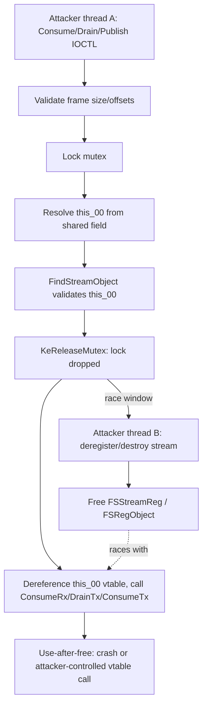

# CVE-2026-69963

**CVE:** CVE-2026-69963  
**Title:** Kernel Streaming Service Driver Elevation of Privilege Vulnerability  
**Source:** [https://msrc.microsoft.com/update-guide/vulnerability/CVE-2026-69963](https://msrc.microsoft.com/update-guide/vulnerability/CVE-2026-69963)  
**Component(s):** mskssrv.sys  
**Patched Date:** 2026-10-13T07:00:00  
**CWE:** Heap-based buffer overflow in Microsoft Streaming Service allows an authorized attacker to elevate privileges locally.  

---

## Related CVEs (Same Component)

This report covers 4 CVEs affecting the same component(s):

- **CVE-2026-69963**  
- CVE-2026-69964  
- CVE-2026-69966  
- CVE-2026-69970  

### Detailed Information

#### CVE-2026-69964

**Title:** Kernel Streaming Service Driver Elevation of Privilege Vulnerability  
**Source:** [https://msrc.microsoft.com/update-guide/vulnerability/CVE-2026-69964](https://msrc.microsoft.com/update-guide/vulnerability/CVE-2026-69964)  
**Patched Date:** 2026-10-13T07:00:00  
**CWE:** Use after free in Microsoft Streaming Service allows an authorized attacker to elevate privileges locally.  

#### CVE-2026-69966

**Title:** Kernel Streaming Service Driver Elevation of Privilege Vulnerability  
**Source:** [https://msrc.microsoft.com/update-guide/vulnerability/CVE-2026-69966](https://msrc.microsoft.com/update-guide/vulnerability/CVE-2026-69966)  
**Patched Date:** 2026-10-13T07:00:00  
**CWE:** Integer overflow or wraparound in Microsoft Streaming Service allows an authorized attacker to elevate privileges locally.  

#### CVE-2026-69970

**Title:** Kernel Streaming Service Driver Elevation of Privilege Vulnerability  
**Source:** [https://msrc.microsoft.com/update-guide/vulnerability/CVE-2026-69970](https://msrc.microsoft.com/update-guide/vulnerability/CVE-2026-69970)  
**Patched Date:** 2026-10-13T07:00:00  
**CWE:** Heap-based buffer overflow in Microsoft Streaming Service allows an authorized attacker to elevate privileges locally.  

---

Download Patched & Vulnerable Components:

```bash
# mskssrv.sys
wget https://msdl.microsoft.com/download/symbols/mskssrv.sys/BC7FEA6814000/mskssrv.sys -O mskssrv.sys.10.0.26100.9549 # vulnerable
wget https://msdl.microsoft.com/download/symbols/mskssrv.sys/17FA3B1114000/mskssrv.sys -O mskssrv.sys.10.0.26100.9711 # patched
```

## Version Tracking Analysis

**Command:**

```
python ghidra_scripts\ghidra_vt_wrapper.py --old-binary ./reports/2026-Oct/CVE-2026-69963/mskssrv.sys.10.0.26100.9549 --new-binary ./reports/2026-Oct/CVE-2026-69963/mskssrv.sys.10.0.26100.9711 --project-dir ./reports/2026-Oct/CVE-2026-69963/ghidra_project --project-name mskssrv.sys_CVE-2026-69963 --ghidra-dir C:\Tools\ghidra_11.4.2_PUBLIC_20250826\ghidra_11.4.2_PUBLIC --output-dir ./reports/2026-Oct/CVE-2026-69963/ghidra_project/vt_results --max-memory 16g
```

Patched Functions: 5 | New Functions: 3 | Removed Functions: 1 | Total Matches: 1276 | Accepted Matches: 1223

### Patched Functions

| Function Name | Source Address | Dest Address | Similarity | Confidence |
| --- | --- | --- | --- | --- |
| `FSRendezvousServer::PublishTx` | `14000cacc` | `14000cba8` | 0.655 | 10.0 |
| `FSRendezvousServer::ConsumeRx` | `14000bea8` | `14000bea8` | 0.644 | 10.0 |
| `FSRendezvousServer::DrainTx` | `14000c16c` | `14000c1e0` | 0.644 | 10.0 |
| `FSRendezvousServer::PublishRx` | `14000c998` | `14000ca44` | 0.620 | 10.0 |
| `FSRendezvousServer::ConsumeTx` | `14000c014` | `14000c04c` | 0.525 | 10.0 |

### New Functions

| Function Name | Address |
| --- | --- |
| `Feature_1842242875__private_IsEnabledDeviceUsageNoInline` | `140002cb4` |
| `Feature_1842242875__private_IsEnabledFallback` | `140002cec` |
| `_guard_dispatch_icall` | `140003110` |

### Removed Functions

| Function Name | Address |
| --- | --- |
| `_guard_dispatch_icall` | `1400030c0` |

---

# AI Technical Analysis

## Vulnerability Identification

**Core Vulnerable Function(s):**
- `FSRendezvousServer::ConsumeRx()` - Uses a stream
  registration pointer after releasing the only lock that
  protected it, with no reference held.
- `FSRendezvousServer::DrainTx()` - Identical pattern to
  `ConsumeRx()`.
- `FSRendezvousServer::ConsumeTx()` - Identical pattern to
  `ConsumeRx()`.
- `FSRendezvousServer::PublishRx()` - Identical pattern to
  `ConsumeRx()`.
- `FSRendezvousServer::PublishTx()` - Identical pattern to
  `ConsumeRx()`.

**Supporting Changes:**
- `Feature_1842242875__private_IsEnabledDeviceUsageNoInline()`
  - New feature-flag gate controlling whether the refcount
  fix is active.
- `FSRegObject::Release()` - New call added at the shared
  exit path to drop the reference taken earlier.
- `FindStreamObject()` / `Lock()` / `KeReleaseMutex()` -
  Pre-existing lookup/locking primitives whose window of
  protection is extended by the patch, not themselves
  altered.

**Unrelated Changes:**
- Local variable renumbering (`cVar5`->`cVar6`,
  `bVar6`->`bVar7`, `lVar7`->`lVar8`) and the collapse of
  multiple `return` statements into `goto` targets
  (`LAB_14000c00c`, `LAB_14000c344`, `LAB_14000c19f`,
  `LAB_14000cb6d`, `LAB_14000ccea`) are structural
  refactors to create a single exit point; not a
  vulnerability by themselves, only the mechanism that
  makes the real fix (the `Release()` call) reachable from
  every return path.

---

## Root Cause Analysis

The flaw is a classic time-of-check-to-time-of-use (TOCTOU)
use-after-free: each function looks up a shared
`FSStreamReg` object while holding a mutex, releases the
mutex, and then continues to dereference and invoke virtual
functions on that same pointer without ever having taken a
reference to keep it alive. The invariant violated is "an
object may only be used while a reference or lock
guarantees its lifetime"; here the lock is dropped before
the object's lifetime is otherwise protected.

Vulnerable code (representative, from `ConsumeRx`):

```c
this_00 = *(FSStreamReg **)(*(longlong *)(lVar3 + 0x30) + 0x20);
bVar6 = FindStreamObject(this,(FSRegObject *)this_00);
KeReleaseMutex(this + 8,0);
if (bVar6) {
  (**(code **)(*(longlong *)this_00 + 0x28))(this_00);
  lVar7 = FSStreamReg::ConsumeRx(this_00,pFVar4);
  if (-1 < lVar7) {
    FSStreamReg::GetStats(this_00,(FSQueueStats *)(pFVar4 + 8));
  }
  (**(code **)(*(longlong *)this_00 + 0x30))(this_00);
  ...
}
```

`this_00` is read from a shared per-device field at
`lVar3 + 0x30 + 0x20`. `FindStreamObject(this, this_00)`
walks a registry protected by the mutex at `this + 8` to
confirm the pointer currently refers to a registered
object, returning `bVar6`. Immediately after this
validation, `KeReleaseMutex` drops the only synchronization
that guaranteed `this_00` remained valid. The code then
treats `this_00` as a C++ object, reading its vtable
pointer (`*(longlong *)this_00`) and invoking member
functions at offsets `0x28` and `0x30`, plus
`FSStreamReg::ConsumeRx`/`DrainTx`/`ConsumeTx` and
`GetStats`, all operating on the now-unprotected pointer.
If a second thread acquires the same mutex and tears down
or deregisters that `FSStreamReg`/`FSRegObject` between the
`KeReleaseMutex` call and these dereferences, `this_00`
becomes dangling. Because the freed kernel pool allocation
can be reclaimed and refilled, the subsequent
vtable-indirect calls operate on attacker-influenced memory.

---

## Execution and Trigger Flow

The functions are reachable only from a process that passes
`KsIsCurrentProcessFrameServer()` (in `ConsumeRx`, `DrainTx`,
`PublishTx`) or that otherwise drives the Kernel Streaming
rendezvous/frame-server IOCTL surface (`ConsumeTx`,
`PublishRx`), so the attack requires two concurrent
execution contexts operating on the same stream registration
inside that privileged-but-reachable component. Thread A
issues a consume/drain/publish request carrying a valid
frame buffer; the driver validates frame-size and offset
fields, then takes the mutex, resolves `this_00` via the
shared field, calls `FindStreamObject` to confirm it is
still registered, and releases the mutex. Thread B
concurrently drives the path that unregisters or destroys
that same stream object (e.g., closing the associated
handle/pin), which acquires the identical mutex and, once
Thread A has released it, frees the `FSStreamReg`/
`FSRegObject` memory. Thread A then resumes execution after
`KeReleaseMutex` and dereferences the now-freed `this_00` to
fetch its vtable and invoke member functions, triggering a
kernel-mode use-after-free. Depending on pool-reuse timing,
this can manifest as a crash (denial of service) or, with a
controlled reallocation (pool spraying) placing attacker
data at the freed address, as a fake-vtable call yielding
kernel code execution and local privilege escalation.



---

## Patch Analysis

Patched flow (representative, from `ConsumeRx`):

```diff
         this_00 = *(FSStreamReg **)(*(longlong *)(lVar3 + 0x30) + 0x20);
-        bVar6 = FindStreamObject(this,(FSRegObject *)this_00);
+        bVar7 = FindStreamObject(this,(FSRegObject *)this_00);
+        uVar9 = Feature_1842242875__private_IsEnabledDeviceUsageNoInline();
+        if (((int)uVar9 != 0) && (bVar7)) {
+          LOCK();
+          *(int *)(this_00 + 0x18) = *(int *)(this_00 + 0x18) + 1;
+          UNLOCK();
+        }
         KeReleaseMutex(this + 8,0);
-        if (bVar6) {
+        if (bVar7) {
           ... use this_00 ...
-          return lVar7;
+          goto LAB_14000c00c;
         }
-        goto LAB_14000bef2;
+        goto LAB_14000befb;
...
+LAB_14000c00c:
+  uVar9 = Feature_1842242875__private_IsEnabledDeviceUsageNoInline();
+  if (((int)uVar9 != 0) && (bVar7 != false)) {
+    FSRegObject::Release((FSRegObject *)this_00);
+  }
+  return lVar8;
```

The patch inserts an atomic, `LOCK`-prefixed increment of a
refcount field at `this_00 + 0x18` while the mutex is still
held and `FindStreamObject` has confirmed the object is
live. Because this increment happens before
`KeReleaseMutex`, it closes the TOCTOU window: destruction
code that respects this refcount can no longer free the
object while it is still in use. All of the function's
previously scattered `return` statements are rewritten as
`goto` jumps to a single shared exit label, and that label
unconditionally calls `FSRegObject::Release(this_00)` when
the earlier increment occurred, guaranteeing the matching
decrement fires on every code path, including early
failure/skip paths. The same transformation is applied
identically to `DrainTx`, `ConsumeTx`, `PublishRx`, and
`PublishTx`, confirming all five shared the same bug and
receive the same fix.

The fix correctly pairs acquisition and release of a
reference around the exact window in which `this_00` is
dereferenced, which is the textbook remediation for this
class of use-after-free, and the use of a centralized exit
label removes the risk of a future code path forgetting to
release the reference. The increment/decrement being
atomic (`LOCK`/`UNLOCK`) is also correct for a
multi-threaded refcounted object. One caveat is that the
entire fix is conditioned on
`Feature_1842242875__private_IsEnabledDeviceUsageNoInline()`
returning non-zero; if that feature flag is disabled, the
original unprotected lookup-then-use pattern remains
reachable and exploitable exactly as before.

Overall, this patch eliminates a kernel-mode use-after-free
in a privileged Kernel Streaming frame-server driver that
could otherwise be leveraged for denial of service or local
privilege escalation via pool-reuse-based vtable hijacking.