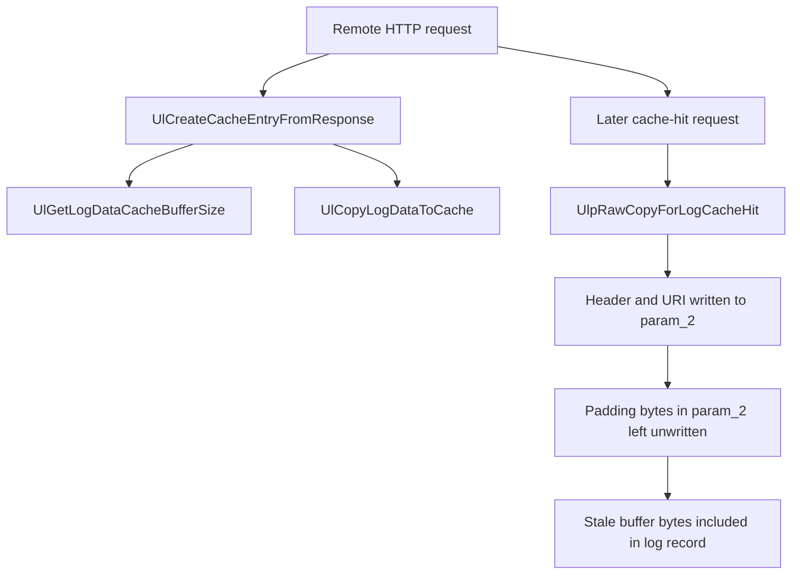

# CVE-2026-70024

**CVE:** CVE-2026-70024  
**Title:** Windows Internet Information Services Remote Code Execution Vulnerability  
**Source:** [https://msrc.microsoft.com/update-guide/vulnerability/CVE-2026-70024](https://msrc.microsoft.com/update-guide/vulnerability/CVE-2026-70024)  
**Component(s):** http.sys  
**Patched Date:** 2026-10-13T07:00:00  
**CWE:** Stack-based buffer overflow in Windows Internet Information Services allows an unauthorized attacker to execute code over a network.  

---

## Related CVEs (Same Component)

This report covers 3 CVEs affecting the same component(s):

- **CVE-2026-70024**  
- CVE-2026-78459  
- CVE-2026-97830  

### Detailed Information

#### CVE-2026-78459

**Title:** Microsoft Internet Information Services Elevation of Privilege Vulnerability  
**Source:** [https://msrc.microsoft.com/update-guide/vulnerability/CVE-2026-78459](https://msrc.microsoft.com/update-guide/vulnerability/CVE-2026-78459)  
**Patched Date:** 2026-10-13T07:00:00  
**CWE:** Heap-based buffer overflow in Windows Internet Information Services allows an authorized attacker to elevate privileges locally.  

#### CVE-2026-97830

**Title:** Windows Internet Information Services Denial of Service Vulnerability  
**Source:** [https://msrc.microsoft.com/update-guide/vulnerability/CVE-2026-97830](https://msrc.microsoft.com/update-guide/vulnerability/CVE-2026-97830)  
**Patched Date:** 2026-10-13T07:00:00  
**CWE:** Double free in Windows Internet Information Services allows an unauthorized attacker to deny service over a network.  

---

Download Patched & Vulnerable Components:

```bash
# http.sys
wget https://msdl.microsoft.com/download/symbols/http.sys/36C66571216000/http.sys -O http.sys.10.0.26100.9549 # vulnerable
wget https://msdl.microsoft.com/download/symbols/http.sys/AC6B1965217000/http.sys -O http.sys.10.0.26100.9711 # patched
```

## Version Tracking Analysis

**Command:**

```
python ghidra_scripts\ghidra_vt_wrapper.py --old-binary ./reports/2026-Oct/CVE-2026-70024/http.sys.10.0.26100.9549 --new-binary ./reports/2026-Oct/CVE-2026-70024/http.sys.10.0.26100.9711 --project-dir ./reports/2026-Oct/CVE-2026-70024/ghidra_project --project-name http.sys_CVE-2026-70024 --ghidra-dir C:\Tools\ghidra_11.4.2_PUBLIC_20250826\ghidra_11.4.2_PUBLIC --output-dir ./reports/2026-Oct/CVE-2026-70024/ghidra_project/vt_results --max-memory 16g
```

Patched Functions: 6 | New Functions: 30 | Removed Functions: 22 | Total Matches: 40817 | Accepted Matches: 25681

### Patched Functions

| Function Name | Source Address | Dest Address | Similarity | Confidence |
| --- | --- | --- | --- | --- |
| `UlCreateCacheEntryFromResponse` | `14006b3a0` | `14006b3a0` | 0.978 | 10.0 |
| `UlpRawCopyForLogCacheMiss` | `14010b5e0` | `14010b890` | 0.881 | 10.0 |
| `UlpRawCopyForLogCacheHit` | `14010b2a0` | `14010b540` | 0.881 | 10.0 |
| `UxStartEnvironmentModule` | `1400b48a0` | `1400b47d0` | 0.858 | 10.0 |
| `UlpRawCopyCacheNotification` | `14010b240` | `14010b4c0` | 0.729 | 10.0 |
| `UlCopyLogDataToCache` | `14009a998` | `1400dcf94` | 0.696 | 10.0 |

### New Functions

*Showing 10 of 30 new functions*

| Function Name | Address |
| --- | --- |
| `FUN_140061574` | `140061574` |
| `Feature_1572240697__private_IsEnabledDeviceUsageNoInline` | `1400b2dc0` |
| `Feature_1572240697__private_IsEnabledFallback` | `1400b2df8` |
| `Feature_2624748857__private_IsEnabledDeviceUsageNoInline` | `1400b2e68` |
| `Feature_2624748857__private_IsEnabledFallback` | `1400b2ea0` |
| `Feature_632192315__private_IsEnabledDeviceUsageNoInline` | `1400b315c` |
| `Feature_632192315__private_IsEnabledFallback` | `1400b3194` |
| `Feature_963542329__private_IsEnabledDeviceUsageNoInline` | `1400b3204` |
| `Feature_963542329__private_IsEnabledFallback` | `1400b323c` |
| `_guard_dispatch_icall` | `140166290` |

### Removed Functions

*Showing 10 of 22 removed functions*

| Function Name | Address |
| --- | --- |
| `FUN_140061574` | `140061574` |
| `_guard_dispatch_icall` | `140165fa0` |
| `FUN_14016e3fa` | `14016e3fa` |
| `FUN_14016e403` | `14016e403` |
| `FUN_14016e485` | `14016e485` |
| `FUN_14016e48d` | `14016e48d` |
| `FUN_14016f666` | `14016f666` |
| `FUN_140172d94` | `140172d94` |
| `FUN_140172dd1` | `140172dd1` |
| `FUN_140174bdc` | `140174bdc` |

---

# AI Technical Analysis

## Vulnerability Identification

**Core Vulnerable Function(s):**
- `UlpRawCopyForLogCacheHit()` - Writes a raw log record into
  the caller buffer `param_2` without first zeroing it. Padding
  and unwritten bytes keep stale data from the buffer.
- `UlpRawCopyForLogCacheMiss()` - Same flaw on the cache-miss
  path. The buffer is only partially filled and is never
  cleared first.
- `UlpRawCopyCacheNotification()` - Same flaw. It copies a
  header only when `param_3 > 7` and leaves the rest of the
  buffer untouched.

**Supporting Changes:**
- `UxStartEnvironmentModule()` - Reads the new feature flag
  `Feature_2624748857` into `UxKirInitRawCopyForLogCacheHit`.
  The three functions above check this flag before calling
  `memset()`. It also adds three other flags and their WPP
  trace messages.
- `UlCreateCacheEntryFromResponse()` - Calls
  `UlCopyLogDataToCache()`. The only added local is
  `local_64`, a `ushort` that is zero-initialised and passed as
  an argument.

**Unrelated Changes:**
- `UlCreateCacheEntryFromResponse()` - Also contains renumbered
  locals and labels, changed `DAT_1401a7xxx` addresses, new
  WPP GUIDs, and shifted stack offsets. These come from
  recompilation and are not security-relevant.
- WPP trace GUID and `DAT_` address changes in all functions are
  rebuild artifacts.

---

## Root Cause Analysis

**High-level explanation.** The raw log-copy routines fill an
output buffer, `param_2` with length `param_3`, with a log
record. They do not initialise the whole buffer. Bytes that the
routines do not write, such as alignment padding between the
header and the URI string and any tail after the URI, keep
whatever the buffer held before. The code assumes the buffer
holds no sensitive data, or that every byte is written. Neither
is guaranteed. The result is an uninitialised-memory
information disclosure.

**Vulnerable code (before), `UlpRawCopyCacheNotification`:**

```c
if ((DAT_1401a6d28 & 8) != 0) {
  WPP_SF_I(0x503,0x17,&WPP_b166ad65..._Traceguids,param_2);
}
if (7 < param_3) {
  *param_2 = *param_1;
  ...
```

**Vulnerable code (before), `UlpRawCopyForLogCacheHit`:**

```c
uVar15 = 0x10;
local_res18 = param_3;
...
if (uVar10 < local_res18) {
  ...
  if (4 < uVar6) {
    uVar15 = (uVar6 + 3 & 0xfffffff8) + 0x10;
  }
  if (uVar13 < uVar15) { return; }
  *param_2 = uVar14;
  param_2[1] = uVar6;
  memmove(param_2 + 6,pvVar9,(ulonglong)uVar6);
  puVar11 = param_2 + 8;
```

**Detailed analysis.** In `UlpRawCopyForLogCacheHit()`, the
required size `uVar15` is computed as
`((uVar6 + 3) & 0xfffffff8) + 0x10`, where `uVar6` is the URI
path length. This rounds the record up to a multiple of 8
bytes. Only `*param_2`, `param_2[1]`, and `uVar6` bytes copied
by `memmove()` to `param_2 + 6` are written. Any rounding
padding between the end of the URI and the aligned record size
is never written. The reserved fields between `param_2[1]` and
`param_2 + 6` are also never written. The routine also has
early `return` paths, for example when `uVar6 == 0` or
`pvVar9 == NULL`, that leave the whole buffer untouched.
`UlpRawCopyCacheNotification()` writes only when
`7 < param_3` and copies only 8 bytes from `param_1`.
`UlpRawCopyForLogCacheMiss()` copies fields from the cached
`lVar2` and `lVar3` structures into `param_2` and has no
initial clear. In each routine the caller supplies `param_3`
as the buffer size, so every byte not written within that
size is exposed. The diff does not show who allocates the
buffer. It does show that the fix is a `memset()` of
`param_3` bytes, which implies the buffer can hold
uninitialised data. Because the data in these buffers goes into
the HTTP log, the leaked bytes reach log consumers.

---

## Execution and Trigger Flow

The attacker sends HTTP requests to a server that uses
http.sys with response caching and raw logging. The request
URI is cached by `UlCreateCacheEntryFromResponse()`. This
function calls `UlCopyLogDataToCache()` with a log buffer
size `local_68[0]`, which comes from
`UlGetLogDataCacheBufferSize()`. The log-data buffer is carved
out of a cache entry allocation. That allocation is not
guaranteed to be zeroed, because the diff shows no clearing of
it. When a later request hits the cache, the log path calls
`UlpRawCopyForLogCacheHit()` with the destination buffer
`param_2` and its size `param_3`. The routine writes the
header, copies the URI path with `memmove()`, and leaves the
padding bytes untouched. Whatever the buffer held before is
then part of the log record. The cache-miss and notification
variants behave the same way. The attacker chooses the URI
length. This controls how many padding bytes remain unwritten
and the path through the function. The attacker needs a
reader for the log record to see the leaked bytes. The diff
does not show who that reader is, so the exact exposure is not
established here.



---

## Patch Analysis

**Patched code:**

```diff
+  if (UxKirInitRawCopyForLogCacheHit != '\0') {
+    memset(param_2,0,(ulonglong)param_3);
+  }
```

This block is added at the top of `UlpRawCopyForLogCacheHit()`,
`UlpRawCopyForLogCacheMiss()` and
`UlpRawCopyCacheNotification()`. In `UxStartEnvironmentModule()`
the flag is set as follows:

```diff
+    iVar3 = Feature_2624748857__private_IsEnabledDeviceUsageNoInline();
+    UxKirInitRawCopyForLogCacheHit = iVar3 != 0;
```

**Technical explanation.** The patch zeroes `param_3` bytes at
`param_2` before any field is written. Padding, reserved
fields, and the unused tail therefore hold zero, and the early
`return` paths leave a zeroed buffer. The `memset()` is gated
by `UxKirInitRawCopyForLogCacheHit`. This global is a
Known Issue Rollback (KIR) style flag read once at startup from
a feature-state query. The `UlpRawCopyForLogCacheHit()` diff
also removes the duplicated `uVar13` copy of the size and
uses `param_3` and `local_res18` directly. This is a
compiler-level cleanup with no change in behaviour. The new
flags `UxKirFixPointerLeakInRawLog` and
`UxKirInitRawCopyLogHeader` are set in the same function, and
the diff shows no consumer for them in these five functions.

**Effectiveness evaluation.** Zeroing the whole destination
buffer addresses the cause for every byte in `param_3`,
including padding the code cannot easily enumerate. It does
not depend on the URI length or the branch taken. The
`memset()` runs before the WPP trace call in the
`UlpRawCopyForLogCacheHit()` path, so the trace sees a cleared
buffer. The fix is only active when the feature flag is
enabled. If the flag is off, the original behaviour remains.
The `memset()` length is `param_3`, which the callers already
use as the buffer bound. If a caller passed a `param_3` larger
than the real buffer, `memset()` would itself overrun it.
The diff does not show such a caller.

**Security impact summary.** Before the patch, bytes left over
in the log buffer could appear in raw log records, which is a
kernel memory information disclosure. After the patch, with the
feature enabled, every byte of the buffer is initialised before
use and unwritten bytes read as zero.