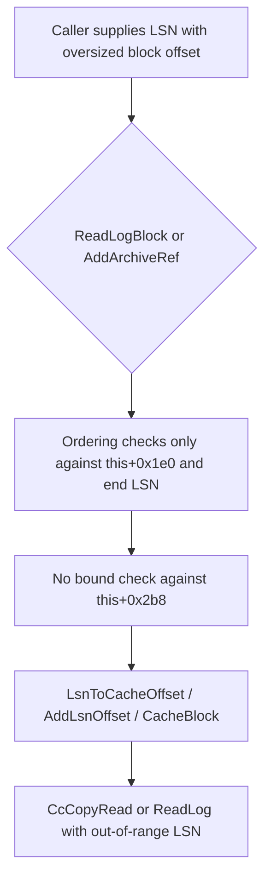

# CVE-2026-70233

**CVE:** CVE-2026-70233  
**Title:** Windows Common Log File System Driver Elevation of Privilege Vulnerability  
**Source:** [https://msrc.microsoft.com/update-guide/vulnerability/CVE-2026-70233](https://msrc.microsoft.com/update-guide/vulnerability/CVE-2026-70233)  
**Component(s):** clfs.sys  
**Patched Date:** 2026-10-13T07:00:00  
**CWE:** Heap-based buffer overflow in Windows Common Log File System Driver allows an authorized attacker to elevate privileges locally.  

---

## Related CVEs (Same Component)

This report covers 5 CVEs affecting the same component(s):

- **CVE-2026-70233**  
- CVE-2026-83835  
- CVE-2026-85355  
- CVE-2026-85868  
- CVE-2026-85870  

### Detailed Information

#### CVE-2026-83835

**Title:** Windows Common Log File System Driver Information Disclosure Vulnerability  
**Source:** [https://msrc.microsoft.com/update-guide/vulnerability/CVE-2026-83835](https://msrc.microsoft.com/update-guide/vulnerability/CVE-2026-83835)  
**Patched Date:** 2026-10-13T07:00:00  
**CWE:** Buffer over-read in Windows Common Log File System Driver allows an authorized attacker to disclose information locally.  

#### CVE-2026-85355

**Title:** Windows Common Log File System Driver Elevation of Privilege Vulnerability  
**Source:** [https://msrc.microsoft.com/update-guide/vulnerability/CVE-2026-85355](https://msrc.microsoft.com/update-guide/vulnerability/CVE-2026-85355)  
**Patched Date:** 2026-10-13T07:00:00  
**CWE:** Inclusion of functionality from untrusted control sphere in Windows Common Log File System Driver allows an authorized attacker to elevate privileges locally.  

#### CVE-2026-85868

**Title:** Windows Common Log File System Driver Elevation of Privilege Vulnerability  
**Source:** [https://msrc.microsoft.com/update-guide/vulnerability/CVE-2026-85868](https://msrc.microsoft.com/update-guide/vulnerability/CVE-2026-85868)  
**Patched Date:** 2026-10-13T07:00:00  
**CWE:** Use after free in Windows Common Log File System Driver allows an authorized attacker to elevate privileges locally.  

#### CVE-2026-85870

**Title:** Windows Common Log File System Driver Elevation of Privilege Vulnerability  
**Source:** [https://msrc.microsoft.com/update-guide/vulnerability/CVE-2026-85870](https://msrc.microsoft.com/update-guide/vulnerability/CVE-2026-85870)  
**Patched Date:** 2026-10-13T07:00:00  
**CWE:** Heap-based buffer overflow in Windows Common Log File System Driver allows an authorized attacker to elevate privileges locally.  

---

Download Patched & Vulnerable Components:

```bash
# clfs.sys
wget https://msdl.microsoft.com/download/symbols/clfs.sys/FC644E3C8C000/clfs.sys -O clfs.sys.10.0.26100.9549 # vulnerable
wget https://msdl.microsoft.com/download/symbols/clfs.sys/9A56643B8D000/clfs.sys -O clfs.sys.10.0.26100.9711 # patched
```

## Version Tracking Analysis

**Command:**

```
python ghidra_scripts\ghidra_vt_wrapper.py --old-binary ./reports/2026-Oct/CVE-2026-70233/clfs.sys.10.0.26100.9549 --new-binary ./reports/2026-Oct/CVE-2026-70233/clfs.sys.10.0.26100.9711 --project-dir ./reports/2026-Oct/CVE-2026-70233/ghidra_project --project-name clfs.sys_CVE-2026-70233 --ghidra-dir C:\Tools\ghidra_11.4.2_PUBLIC_20250826\ghidra_11.4.2_PUBLIC --output-dir ./reports/2026-Oct/CVE-2026-70233/ghidra_project/vt_results --max-memory 16g
```

Patched Functions: 11 | New Functions: 15 | Removed Functions: 1 | Total Matches: 12357 | Accepted Matches: 9405

### Patched Functions

*Showing top 10 of 11 patched functions*

| Function Name | Source Address | Dest Address | Similarity | Confidence |
| --- | --- | --- | --- | --- |
| `CClfsLogFcbPhysical::TruncateLogModifyStreams` | `14004b7dc` | `14004c92c` | 0.960 | 10.0 |
| `CClfsLogFcbPhysical::ReadLogBlock` | `14000eda0` | `14000eda0` | 0.940 | 10.0 |
| `CClfsLogFcbPhysical::TruncateLogStart` | `14004c144` | `14004d2b8` | 0.921 | 10.0 |
| `CClfsLogFcbPhysical::AddArchiveRef` | `140046cf0` | `140047d50` | 0.919 | 10.0 |
| `CClfsLogFcbPhysical::GetArchiveDescriptors` | `1400492d0` | `14004a360` | 0.911 | 10.0 |
| `CClfsLogFcbVirtual::Open` | `1400735e8` | `14007ab54` | 0.792 | 10.0 |
| `CClfsLogFcbPhysical::GetContainerName` | `140049870` | `14004a950` | 0.776 | 10.0 |
| `__l1::fin$0` | `1400817ba` | `140082a1a` | 0.762 | 10.0 |
| `CClfsBaseFile::ScanContainerInfo` | `140065424` | `140078a0c` | 0.759 | 10.0 |
| `CClfsBaseFile::GetContainerName` | `14003b148` | `14003c148` | 0.715 | 10.0 |

### New Functions

*Showing 10 of 15 new functions*

| Function Name | Address |
| --- | --- |
| `Feature_44988729__private_IsEnabledDeviceUsageNoInline` | `140011844` |
| `Feature_44988729__private_IsEnabledFallback` | `14001187c` |
| `Feature_793395513__private_IsEnabledDeviceUsageNoInline` | `140011898` |
| `Feature_793395513__private_IsEnabledFallback` | `1400118d0` |
| `Feature_1094352186__private_IsEnabledDeviceUsageNoInline` | `140016dd8` |
| `Feature_1094352186__private_IsEnabledFallback` | `140016e10` |
| `Feature_216157497__private_IsEnabledDeviceUsageNoInline` | `140016e2c` |
| `Feature_216157497__private_IsEnabledFallback` | `140016e64` |
| `Feature_2694725945__private_IsEnabledDeviceUsageNoInline` | `140016e80` |
| `Feature_2694725945__private_IsEnabledFallback` | `140016eb8` |

### Removed Functions

| Function Name | Address |
| --- | --- |
| `_guard_dispatch_icall` | `140018880` |

---

# AI Technical Analysis

## Vulnerability Identification

**Core Vulnerable Function(s):**
- `CClfsLogFcbPhysical::ReadLog​Block()` - Accepts a caller-supplied
  LSN without checking that its block offset is within the log
  size limit stored at `this + 0x2b8`.
- `CClfsLogFcbPhysical::AddArchiveRef()` - Accepts two
  caller-supplied LSNs (`param_3`, `param_4`) with the same missing
  block offset validation before using them for cache and read
  operations.

**Supporting Changes:**
- `CClfsLogFcbPhysical::IsLsnBlockOffsetCanonical()` (new) - The
  validation helper called by both core functions.
- `CClfsLogFcbPhysical::TruncateLogModifyStreams()` and
  `ValidateTruncateRawSectorAlignment()` (new) - A separate
  feature-gated check that the truncate record's block count is a
  multiple of the sector size in 512-byte units. This is
  independent hardening in the same component. It is not the
  primary flaw.

**Unrelated Changes:**
- `CClfsLogFcbPhysical::GetContainerName()` - A feature-gated
  `ExFreePoolWithTag` for the string buffer (`lStack_30`). It
  fixes a pool leak, not an LSN validation issue.
- `CClfsLogFcbVirtual::Open()` - A feature-gated change that
  replaces `KeBugCheckEx` with a `-0x3ffffff3` return for an
  out-of-range `param_1`. It removes a denial of service and does
  not touch the LSN logic.

---

## Root Cause Analysis

The flaw is missing input validation. `ReadLogBlock()` and
`AddArchiveRef()` treat the block-offset field of a caller-supplied
`_CLS_LSN` as trustworthy once it passes ordering comparisons
against the log's first and last LSN. The violated invariant is that
a block offset must be below the log's maximum block count, stored
at `this + 0x2b8`. Only the container and record-sequence ordering
was enforced.

Vulnerable code (before) in `AddArchiveRef()`, after the earlier
parameter checks:

```c
if (bVar17) {
  return -0x3ffffff3;
}
*(undefined8 *)(param_7 + 0x10) = 0;
cVar9 = ExAcquireResourceSharedLite(this + 200,1);
```

Vulnerable code (before) in `ReadLogBlock()`:

```c
puVar12 = (undefined8 *)(**(code **)(*(longlong *)this + 0x160))
                          (this,&local_c0);
local_c0 = (_CLS_LSN *)*puVar12;
if (((param_2 == (_CLS_LSN *)0x0) || ...
  local_c0 = (_CLS_LSN *)(this + 0x1e0);
  uVar2 = operator>=(param_2,local_c0);
```

In `AddArchiveRef()`, the sequence runs from the last validity test
(`bVar17`) straight into `ExAcquireResourceSharedLite`. `param_3`
and `param_4` are never checked against the block-offset limit.
They later feed `ClfsLsnGreater`, `ClfsLsnLess`, `CacheBlock(this,
param_1, param_3, ...)` and the vtable read at offset `0x80`.

In `ReadLogBlock()`, `param_2` is compared only with the value
returned by the vtable call at `0x160` and with `this + 0x1e0`. The
comparison involves just the `uint` halves of the LSN, so the block
offset in the low dword is never bounded by `this + 0x2b8`. The
loop then passes `param_2` through `LsnToCacheOffset`, `AddLsnOffset`
and `CcCopyRead`. The only later limit is
`local_c8 <= *(longlong *)(this + 0x50)` on the final cache offset.
That is a downstream range test and not a canonical-form check on
the LSN.

An LSN with an out-of-range block offset is therefore accepted
and used in offset arithmetic. The existing checks do not reject it.

---

## Execution and Trigger Flow

The attacker supplies an LSN whose block-offset field is greater
than or equal to the limit at `this + 0x2b8`. The limit is non-zero
for the affected log. The diff does not show the user-mode entry
path, so the flow starts at the two functions.

For `ReadLogBlock()`, the caller passes the crafted LSN as
`param_2`. The function checks the log flags and confirms that the
log is not in a state that short-circuits the read. It then
fetches the log end LSN through the vtable call at `0x160`.

Next, it compares `param_2` against that LSN and against
`this + 0x1e0` using only ordering tests. A crafted LSN can satisfy
these tests while carrying an oversized block offset. The read loop
runs next. `AddLsnOffset` and `LsnToCacheOffset` convert the LSN
into a cache offset, and `CcCopyRead` copies data into `local_f0`.

For `AddArchiveRef()`, the same crafted value is passed as `param_3`
or `param_4`. After the parameter checks, the function acquires the
shared resource at `this + 200` and trims the `\??\` prefix. It
then calls `CacheBlock` and the vtable read at offset `0x80` using
the unvalidated LSNs.



---

## Patch Analysis

The patch adds a helper and calls it in both functions, gated by
`Feature_1094352186`:

```diff
+  uVar15 = Feature_1094352186__private_IsEnabledDeviceUsageNoInline();
+  if ((int)uVar15 != 0) {
+    uVar9 = IsLsnBlockOffsetCanonical(this,param_3);
+    if (uVar9 == '\0') {
+      return -0x3ffffff3;
+    }
+    uVar9 = IsLsnBlockOffsetCanonical(this,param_4);
+    if (uVar9 == '\0') {
+      return -0x3ffffff3;
+    }
+  }
```

In `ReadLogBlock()` the check is
`(param_2 != 0 && *(longlong *)param_2 == -0x100000000) ||
IsLsnBlockOffsetCanonical(this, param_2)`. When it fails, the
function returns `-0x3ffffff3` through a new `else` branch.

The helper reads the limit `uVar1 = *(ulonglong *)(this + 0x2b8)`.
If the limit is zero, it returns true. Otherwise it calls
`ClfsLsnBlockOffset(param_1)` and returns true only when the offset
is strictly less than `uVar1`.

`AddArchiveRef()` validates both `param_3` and `param_4` before it
takes the resource lock or touches the output buffer at `param_7`.
`ReadLogBlock()` runs the check before the vtable end-LSN fetch and
before the read loop. Unrelated code paths are not moved. The large
`ReadLogBlock()` diff is mostly re-indentation under the new `if`.
The label renames, such as `LAB_14000f728` to `LAB_14000f778`,
are only address shifts.

The fix is effective for the paths it covers. The check runs before
any offset arithmetic, cache lookup or read, and failure returns the
standard invalid-parameter status `-0x3ffffff3`. The sentinel LSN
`-0x100000000` is exempted in `ReadLogBlock()` so existing
callers that pass the "invalid" value keep working.

Two limits apply, both visible in the diff. A zero `this + 0x2b8`
disables the check, so correctness depends on that field being
initialized. The code is also gated by a feature flag, so builds
with the flag off keep the old behavior.

The patch stops out-of-range LSN block offsets from reaching cache
offset computation and log reads in these two functions. It is a
strict pre-condition check with no behavior change for valid
inputs.