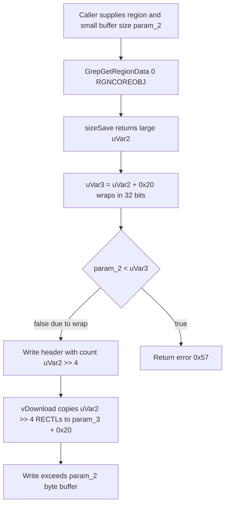

# CVE-2026-70286

**CVE:** CVE-2026-70286  
**Title:** Windows Graphics Component Elevation of Privilege Vulnerability  
**Source:** [https://msrc.microsoft.com/update-guide/vulnerability/CVE-2026-70286](https://msrc.microsoft.com/update-guide/vulnerability/CVE-2026-70286)  
**Component(s):** win32kbase.sys  
**Patched Date:** 2026-10-13T07:00:00  
**CWE:** Heap-based buffer overflow in Windows Win32K - GRFX allows an authorized attacker to elevate privileges locally.  

---

## Related CVEs (Same Component)

This report covers 3 CVEs affecting the same component(s):

- **CVE-2026-70286**  
- CVE-2026-85901  
- CVE-2026-85908  

### Detailed Information

#### CVE-2026-85901

**Title:** Windows Graphics Component Elevation of Privilege Vulnerability  
**Source:** [https://msrc.microsoft.com/update-guide/vulnerability/CVE-2026-85901](https://msrc.microsoft.com/update-guide/vulnerability/CVE-2026-85901)  
**Patched Date:** 2026-10-13T07:00:00  
**CWE:** Heap-based buffer overflow in Windows Win32K - GRFX allows an authorized attacker to elevate privileges locally.  

#### CVE-2026-85908

**Title:** Windows Graphics Component Elevation of Privilege Vulnerability  
**Source:** [https://msrc.microsoft.com/update-guide/vulnerability/CVE-2026-85908](https://msrc.microsoft.com/update-guide/vulnerability/CVE-2026-85908)  
**Patched Date:** 2026-10-13T07:00:00  
**CWE:** Heap-based buffer overflow in Windows Win32K - GRFX allows an authorized attacker to elevate privileges locally.  

---

Download Patched & Vulnerable Components:

```bash
# win32kbase.sys
wget https://msdl.microsoft.com/download/symbols/win32kbase.sys/A9DBE714344000/win32kbase.sys -O win32kbase.sys.10.0.26100.9549 # vulnerable
wget https://msdl.microsoft.com/download/symbols/win32kbase.sys/AB1DFC97345000/win32kbase.sys -O win32kbase.sys.10.0.26100.9711 # patched
```

## Version Tracking Analysis

**Command:**

```
python ghidra_scripts\ghidra_vt_wrapper.py --old-binary ./reports/2026-Oct/CVE-2026-70286/win32kbase.sys.10.0.26100.9549 --new-binary ./reports/2026-Oct/CVE-2026-70286/win32kbase.sys.10.0.26100.9711 --project-dir ./reports/2026-Oct/CVE-2026-70286/ghidra_project --project-name win32kbase.sys_CVE-2026-70286 --ghidra-dir C:\Tools\ghidra_11.4.2_PUBLIC_20250826\ghidra_11.4.2_PUBLIC --output-dir ./reports/2026-Oct/CVE-2026-70286/ghidra_project/vt_results --max-memory 16g
```

Patched Functions: 15 | New Functions: 48 | Removed Functions: 3 | Total Matches: 92723 | Accepted Matches: 56630

### Patched Functions

*Showing top 10 of 15 patched functions*

| Function Name | Source Address | Dest Address | Similarity | Confidence |
| --- | --- | --- | --- | --- |
| `RIMDirectStopUserModeRimDeviceClassNotifications` | `140176060` | `140175a6c` | 0.944 | 10.0 |
| `RIMDirectStartUserModeRimDeviceClassNotifications` | `1401f4aa0` | `1401f5180` | 0.944 | 10.0 |
| `RIMDirectPnpRemoveUserModeRimDevices` | `140183a0c` | `14018332c` | 0.944 | 10.0 |
| `CMouseSensor::PostInitialize` | `14021e650` | `14021ef50` | 0.810 | 10.0 |
| `NtUserSetFeatureReportResponse` | `1401dda40` | `1401dde90` | 0.804 | 10.0 |
| `DirectComposition::TryOpenSharedSectionAndGetUserModeHandle` | `140241d14` | `140242814` | 0.789 | 10.0 |
| `EtwTraceDWMGetDirtyRegion` | `14012b3e0` | `140126d60` | 0.774 | 10.0 |
| `RIMIDECreateHIDDesc` | `14009e8fc` | `140199614` | 0.769 | 10.0 |
| `RIMFreeSpecificDevWorker` | `140155d08` | `14015f810` | 0.752 | 10.0 |
| `RIMGetDevicePropertiesLockfree` | `140162540` | `1401733a0` | 0.703 | 10.0 |

### New Functions

*Showing 10 of 48 new functions*

| Function Name | Address |
| --- | --- |
| `GrepGetRegionData<1,RGNOBJAPI>` | `1400444e4` |
| `numRect` | `1401006fc` |
| `UserDetachQueueFromInputWindowApiExt` | `1401555d0` |
| `Feature_2572050746__private_IsEnabledDeviceUsageNoInline` | `1401be924` |
| `Feature_2572050746__private_IsEnabledFallback` | `1401be95c` |
| `Feature_829055289__private_IsEnabledDeviceUsageNoInline` | `1401ce950` |
| `Feature_829055289__private_IsEnabledFallback` | `1401ce988` |
| `Feature_360346936__private_IsEnabledDeviceUsageNoInline` | `1401d5124` |
| `Feature_360346936__private_IsEnabledFallback` | `1401d515c` |
| `Feature_1117674810__private_IsEnabledDeviceUsageNoInline` | `1401eb70c` |

### Removed Functions

| Function Name | Address |
| --- | --- |
| `_guard_dispatch_icall` | `14024f530` |
| `DxDdGetDxgkWin32kInterface` | `140344000` |
| `DxDdIsTearDownLddmSpriteDisabled` | `140344008` |

---

# AI Technical Analysis

## Vulnerability Identification

**Core Vulnerable Function(s):**
- `GrepGetRegionData<0,RGNCOREOBJ>` - Computes the required buffer size as `sizeSave() + 0x20` in a 32-bit `uint` with no wraparound check. The wrapped value is then used for the caller-buffer size validation, while the unwrapped size drives the copy.

**Supporting Changes:**
- `GrepGetRegionData<1,RGNOBJAPI>` - New sibling template instantiation for `RGNOBJAPI`. It carries the same feature-gated `uVar2 <= uVar1` check, so both region-object variants are covered.
- `numRect` (`RGNCOREOBJ::numRect`) - New function that computes the rectangle count from the region core. It is not part of the check itself.

**Unrelated Changes:**
- `RIMDirectStopUserModeRimDeviceClassNotifications` - Only the lambda and WPP trace GUID were regenerated. No security logic changed.
- `operator_void_(__cdecl*)(RawInputManagerObject_*,void_*)` (both lambda wrappers) - Compiler-generated lambda-to-function-pointer conversions.
- `UserDetachQueueFromInputWindowApiExt` - New API-set forwarding stub that dispatches through a function table.
- `BuildReportDescriptor`, `NtUserSetFeatureReportResponse` and `CMouseSensor::PostInitialize` - These carry their own separate feature-flag-gated hardening (extra descriptor bytes, a lower-bound check on a count field, rundown protection). They are not the region size arithmetic analysed here.

---

## Root Cause Analysis

The flaw is an unchecked 32-bit integer overflow when computing the output size of a region-data export. `GrepGetRegionData` assumes that `sizeSave() + 0x20` is always greater than or equal to `sizeSave()`. That invariant is not enforced. When it fails, the size check that protects the caller's buffer is evaluated against a truncated value, not the real amount of data to be written.

Vulnerable code (before):

```c
uVar2 = RGNCOREOBJ::sizeSave(param_1);
uVar3 = uVar2 + 0x20;              /* uint, may wrap */
if (param_3 != (_RGNDATA *)0x0) {
  if (param_2 < uVar3) {           /* compares wrapped value */
    EngSetLastError(0x57);
    uVar3 = 0;
  }
  else {
    *(undefined4 *)param_3 = 0x20;
    *(undefined4 *)(param_3 + 4) = 1;
    *(ulong *)(param_3 + 8) = uVar2 >> 4;
    *(ulong *)(param_3 + 0xc) = uVar2;
    ...
    RGNCOREOBJ::vDownload(param_1,(_RECTL *)(param_3 + 0x20),
                          (ulonglong)(uVar2 >> 4));
  }
}
return uVar3;
```

`uVar2` holds the region payload size returned by `sizeSave()`. The header size `0x20` is added and stored in the 32-bit `uVar3`. If `uVar2` is close to the top of the 32-bit range, the addition wraps and `uVar3` becomes a small number.

The check `param_2 < uVar3` compares the caller-supplied buffer size `param_2` against that small value, so a modest `param_2` passes. The code then writes the 0x20-byte header into `param_3`. The rectangle count is derived from the unwrapped value (`uVar2 >> 4`) and stored at offset `8`. The original size `uVar2` is stored at offset `0xc`.

`RGNCOREOBJ::vDownload()` is then called with `uVar2 >> 4` rectangles and destination `param_3 + 0x20`. The number of rectangles copied is therefore based on the true region size, while the capacity check used the wrapped size. The write can exceed the buffer of `param_2` bytes.

The function also returns the wrapped `uVar3` to the caller as the "bytes written" value. Callers that rely on it receive an inconsistent size.

---

## Execution and Trigger Flow

An attacker first needs a region whose `sizeSave()` result, when added to `0x20`, wraps a 32-bit unsigned value. This requires a region with a very large rectangle payload.

The attacker then reaches `GrepGetRegionData<0,RGNCOREOBJ>` through a code path that exports region data into a caller-supplied `_RGNDATA` buffer. The attacker supplies `param_3` as a non-null buffer and `param_2` as a small size.

Inside the function, `sizeSave()` returns `uVar2`. The expression `uVar2 + 0x20` is stored in `uVar3` and wraps. The condition `param_2 < uVar3` is false because `uVar3` is small, so the error path is skipped.

The function then writes the header fields, including the count `uVar2 >> 4` and the size `uVar2`. Finally `vDownload()` copies `uVar2 >> 4` rectangles starting at `param_3 + 0x20`. This copy runs past the end of the buffer whose true size is `param_2`. The function returns the wrapped `uVar3` as success.



---

## Patch Analysis

The patch adds a wraparound test in front of the existing logic, gated by the feature flag `Feature_1969648952`.

```diff
-  uVar3 = uVar2 + 0x20;
-  if (param_3 != (_RGNDATA *)0x0) {
+  uVar4 = uVar2 + 0x20;
+  iVar3 = Feature_1969648952__private_IsEnabledDeviceUsageNoInline();
+  if ((iVar3 == 0) || (uVar2 <= uVar4)) {
+    if (param_3 != (_RGNDATA *)0x0) {
       ...
+    }
+  }
+  else {
+    EngSetLastError(0x57);
+    uVar4 = 0;
+  }
-  return uVar3;
+  return uVar4;
```

When the feature is enabled, the function checks `uVar2 <= uVar4`, where `uVar4` is the 32-bit sum. If the addition wrapped, `uVar4` is smaller than `uVar2` and the check fails. The function then calls `EngSetLastError(0x57)` (`ERROR_INVALID_PARAMETER`) and returns `0` before any write to `param_3` occurs.

When the sum does not wrap, the original logic runs unchanged. This includes the `param_2 < uVar4` capacity check, the header writes and the `vDownload()` call. The check also runs when `param_3` is null, so the size-query mode no longer returns a wrapped size.

The same check appears in the new `GrepGetRegionData<1,RGNOBJAPI>`, which means the `RGNOBJAPI` variant is also protected.

The test `uVar2 <= uVar4` is a correct wrap detector for an unsigned addition of a positive constant. Overflow occurs if and only if the result is less than an operand. After the check passes, `param_2 < uVar4` compares against the true required size, so the copy cannot exceed the validated capacity.

One limitation is that the check is gated behind a feature flag. When `iVar3 == 0`, the original behaviour is preserved, so the fix is effective only where the flag is enabled.

Overall, the patch restores the invariant that the size used for validation equals the size used for writing. It removes the out-of-bounds write primitive in kernel memory reachable from `win32kbase.sys` region export. It does this by failing the call with `ERROR_INVALID_PARAMETER` in the wrap case.