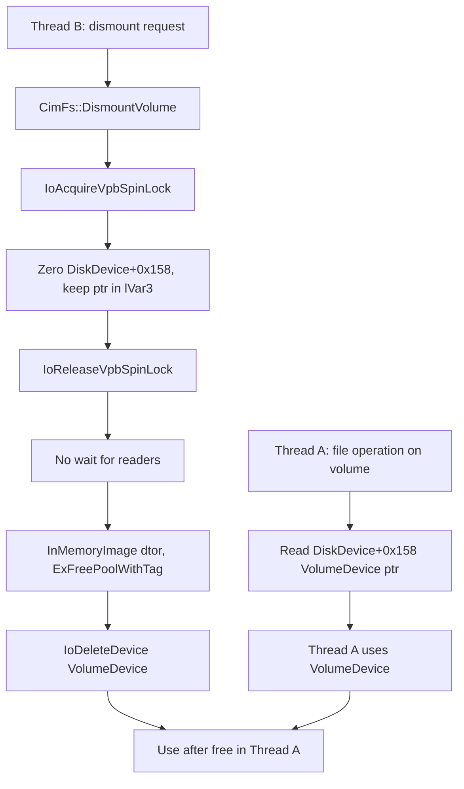

# CVE-2026-85823

**CVE:** CVE-2026-85823  
**Title:** Windows Composite Image File System Elevation of Privilege Vulnerability  
**Source:** [https://msrc.microsoft.com/update-guide/vulnerability/CVE-2026-85823](https://msrc.microsoft.com/update-guide/vulnerability/CVE-2026-85823)  
**Component(s):** cimfs.sys  
**Patched Date:** 2026-10-13T07:00:00  
**CWE:** Use after free in Windows Composite Image File System allows an authorized attacker to elevate privileges locally.  

---

## Related CVEs (Same Component)

This report covers 2 CVEs affecting the same component(s):

- **CVE-2026-85823**  
- CVE-2026-85824  

### Detailed Information

#### CVE-2026-85824

**Title:** Windows Composite Image File System Elevation of Privilege Vulnerability  
**Source:** [https://msrc.microsoft.com/update-guide/vulnerability/CVE-2026-85824](https://msrc.microsoft.com/update-guide/vulnerability/CVE-2026-85824)  
**Patched Date:** 2026-10-13T07:00:00  
**CWE:** Use after free in Windows Composite Image File System allows an authorized attacker to elevate privileges locally.  

---

Download Patched & Vulnerable Components:

```bash
# cimfs.sys
wget https://msdl.microsoft.com/download/symbols/cimfs.sys/68A315C643000/cimfs.sys -O cimfs.sys.10.0.26100.9549 # vulnerable
wget https://msdl.microsoft.com/download/symbols/cimfs.sys/A326D10545000/cimfs.sys -O cimfs.sys.10.0.26100.9711 # patched
```

## Version Tracking Analysis

**Command:**

```
python ghidra_scripts\ghidra_vt_wrapper.py --old-binary ./reports/2026-Oct/CVE-2026-85823/cimfs.sys.10.0.26100.9549 --new-binary ./reports/2026-Oct/CVE-2026-85823/cimfs.sys.10.0.26100.9711 --project-dir ./reports/2026-Oct/CVE-2026-85823/ghidra_project --project-name cimfs.sys_CVE-2026-85823 --ghidra-dir C:\Tools\ghidra_11.4.2_PUBLIC_20250826\ghidra_11.4.2_PUBLIC --output-dir ./reports/2026-Oct/CVE-2026-85823/ghidra_project/vt_results --max-memory 16g
```

Patched Functions: 7 | New Functions: 7 | Removed Functions: 1 | Total Matches: 4357 | Accepted Matches: 4210

### Patched Functions

| Function Name | Source Address | Dest Address | Similarity | Confidence |
| --- | --- | --- | --- | --- |
| `CimFs::CommonCreate` | `14000f274` | `14000f56c` | 0.996 | 10.0 |
| `Cp_DriverEntry` | `140002d88` | `140002d88` | 0.977 | 10.0 |
| `CimFs::MountVolumeFromFileSystem` | `14000b71c` | `14000c1a4` | 0.919 | 10.0 |
| `CimFs::DispatchDiskIoctl` | `1400082f4` | `140008ce8` | 0.814 | 10.0 |
| `CimFs::NotifyChangeDirectory` | `14000c62c` | `14000d0e0` | 0.669 | 10.0 |
| `CimFs::DispatchVolumeCleanup` | `140003710` | `140003710` | 0.658 | 10.0 |
| `CimFs::DismountVolume` | `140005f4c` | `140006914` | 0.620 | 10.0 |

### New Functions

| Function Name | Address |
| --- | --- |
| `Feature_859989307__private_IsEnabledDeviceUsageNoInline` | `140003c2c` |
| `Feature_859989307__private_IsEnabledFallback` | `140003c64` |
| `AcquireDiskVolume` | `140005cd0` |
| `Feature_4081476923__private_IsEnabledDeviceUsageNoInline` | `14000f3f8` |
| `Feature_4081476923__private_IsEnabledFallback` | `14000f430` |
| `scope_exit<<lambda_fdd2067ed7a6b2d0b59e8359ef1bcae4>_>` | `140013200` |
| `_guard_dispatch_icall` | `14002b4d0` |

### Removed Functions

| Function Name | Address |
| --- | --- |
| `_guard_dispatch_icall` | `14002b090` |

---

# AI Technical Analysis

## Vulnerability Identification

**Core Vulnerable Function(s):**
- `CimFs::DismountVolume()` - Detaches the `VolumeDevice` from
  the `DiskDevice` and frees it (`IoDeleteDevice()`) without
  waiting for other threads that still hold the raw pointer. This
  is a use-after-free race.

**Supporting Changes:**
- `CimFs::AcquireDiskVolume()` (new) - Takes rundown protection
  on the `DiskDevice` before returning the `VolumeDevice` pointer.
  It is the consumer-side half of the fix.
- `CimFs::MountVolumeFromFileSystem()` - Enlarges the `DiskDevice`
  extension (0xa0 to 0xb0 bytes) and calls
  `ExInitializeRundownProtection()` on the new field at +0x160.
- `CimFs::DispatchVolumeCleanup()` - Sets a flag under a push lock
  before notify cleanup. It is gated by a separate feature flag
  (`Feature_859989307`).

**Unrelated Changes:**
- `CimFs::CommonCreate()` - Only the `CCB` size changes (0x70 to
  0x78) and the cleanup flag moves from +0x68 to +0x70. The rest
  is relocated labels and addresses.
- `Cp_DriverEntry()` - Only the global lookaside and data
  addresses change, plus a version constant. There is no logic
  change.
- `wil::scope_exit<...>()` (new) - Compiler-generated lambda
  wrapper, not security-relevant.

---

## Root Cause Analysis

The `DiskDevice` holds a raw, non-reference-counted pointer to its
`VolumeDevice` at offset +0x158. `DismountVolume()` clears that
pointer and then destroys the `VolumeDevice`. Nothing waits for
threads that read the pointer before it was cleared and are still
using it. The violated invariant is that an object must not be
freed while a reader that obtained it through a shared pointer can
still dereference it.

Vulnerable code (before patch):

```c
IoAcquireVpbSpinLock(local_res8);
lVar2 = *(longlong *)(param_1 + 0x4b0);
lVar3 = 0;
if ((lVar2 != 0) && (*(uint *)(lVar2 + 0x1c) == (uint)param_2)) {
  pDVar4 = *(DiskDevice **)(lVar2 + 0x10);
  lVar2 = 0xfffe;
  lVar3 = *(longlong *)(pDVar4 + 0x158);
  *(undefined8 *)(pDVar4 + 0x158) = 0;
  ...
}
IoReleaseVpbSpinLock(...);
local_res20 = 0;
if (lVar3 != 0) {
  Cim::InMemoryImage::~InMemoryImage((InMemoryImage *)(lVar3 + 0x240));
  ...
  IoDeleteDevice(lVar3);
}
```

Under the VPB spin lock, the function reads the `VolumeDevice`
pointer from `pDVar4 + 0x158` into `lVar3` and zeroes the field.
It then releases the lock. Right after that, in the `lVar3 != 0`
block, it destroys the `InMemoryImage` at `lVar3 + 0x240` and frees
the buffer at `lVar3 + 0x170`. It then destroys the
`MappedRegion` array at `lVar3 + 0x168` and calls
`IoDeleteDevice(lVar3)`.

No synchronization exists between releasing the VPB spin lock and
these teardown steps. The new `AcquireDiskVolume()` shows that
other code reads `*(param_1 + 0x158)` directly (its disabled-feature
branch is a plain load). Any thread that loaded the pointer before
it was zeroed holds a pointer that `IoDeleteDevice(lVar3)` can free
while the thread is still using it. This gives a use-after-free
with a window between the load and the last use.

The diff does not show the callers of `AcquireDiskVolume()`, so the
exact reading paths are not identified here.

---

## Execution and Trigger Flow

The attacker needs the ability to mount a CimFs volume and to issue
file operations against it, which is normal for a local
low-privileged process. One thread issues an operation that
resolves the volume through the `DiskDevice` and reads
`*(DiskDevice + 0x158)`, obtaining the `VolumeDevice` pointer. That
thread keeps using the pointer afterwards.

At the same time, a second thread triggers the dismount, which
reaches `DismountVolume()`. The dismount path takes the VPB spin
lock and validates the VPB. It then reads the `VolumeDevice`
pointer, zeroes the `DiskDevice` slot and releases the spin lock.
The dismount thread proceeds directly to `~InMemoryImage()`,
`ExFreePoolWithTag()` and `IoDeleteDevice()`.

Because the first thread already holds the pointer, the
zeroed slot does not protect it. After `IoDeleteDevice()` the
device object and its extension are freed. The first thread then
dereferences freed memory. Reclaiming the freed pool with
attacker-controlled data can turn this into memory corruption in
kernel mode.



---

## Patch Analysis

Patched code (`DismountVolume()` and the new helper):

```diff
 IoReleaseVpbSpinLock(...);
+uVar2 = Feature_4081476923__private_IsEnabledDeviceUsageNoInline();
+if (((int)uVar2 != 0) && (pDVar4 != (DiskDevice *)0x0)) {
+  ExWaitForRundownProtectionRelease(pDVar4 + 0x160);
+}
 local_res20 = 0;
```

```c
cVar1 = ExAcquireRundownProtection(param_1 + 0x160);
if (cVar1 == '\0') {
  pVVar3 = 0;
} else {
  pVVar3 = *(VolumeDevice **)(param_1 + 0x158);
  if (pVVar3 == 0)
    ExReleaseRundownProtection(param_1 + 0x160);
}
```

`MountVolumeFromFileSystem()` now allocates a `DiskDevice`
extension of 0xb0 bytes instead of 0xa0. It initializes the
rundown reference at +0x160 with `ExInitializeRundownProtection()`
and shifts the later fields (+0x168 onward, and the flag at +0x1f0)
to make room. `DismountVolume()` is updated to use the new flag
offset 0x1f0.

The patch adds a rundown-protection reference on the `DiskDevice`.
`AcquireDiskVolume()` first calls `ExAcquireRundownProtection()`.
If that fails, the disk is being torn down and the caller gets
`NULL`. If it succeeds, the function reads the `VolumeDevice`
pointer and returns it with the reference still held. If the
pointer is already `NULL`, the function releases the reference
immediately. `DismountVolume()` calls
`ExWaitForRundownProtectionRelease()` after clearing the pointer
and before destroying the `VolumeDevice`. This blocks until every
outstanding acquirer has released its reference.

The fix covers the shown race. Once the slot is cleared, new
acquirers either fail or see `NULL`. Acquirers that already hold a
reference keep the `VolumeDevice` alive until they release it.
Teardown cannot start until all of them have released. Its
effectiveness depends on every reader of the +0x158 slot going
through `AcquireDiskVolume()`, and the callers are not visible in
this diff. Both the helper and the wait are gated by the same
feature flag (`Feature_4081476923`), so the protection applies only
when the flag is enabled.

The patch removes the use-after-free window between a reader
obtaining the `VolumeDevice` pointer and the dismount freeing it.
It closes a local kernel memory-corruption primitive, which could
lead to privilege escalation or a system crash.