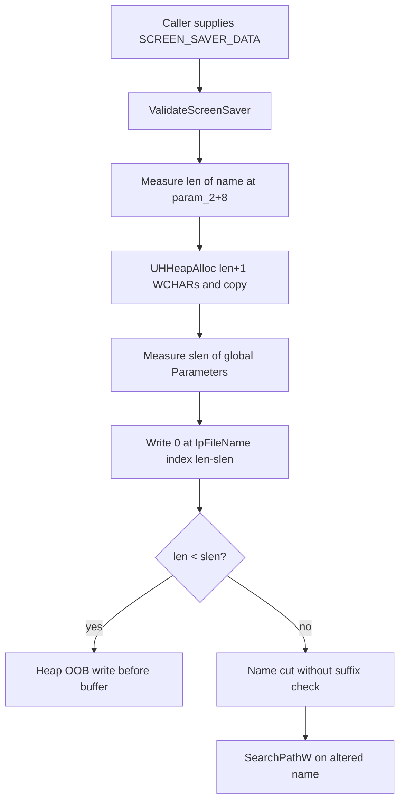

# CVE-2026-87699

**CVE:** CVE-2026-87699  
**Title:** Winlogon Elevation of Privilege Vulnerability  
**Source:** [https://msrc.microsoft.com/update-guide/vulnerability/CVE-2026-87699](https://msrc.microsoft.com/update-guide/vulnerability/CVE-2026-87699)  
**Component(s):** winlogon.exe  
**Patched Date:** 2026-10-13T07:00:00  
**CWE:** Heap-based buffer overflow in Winlogon allows an authorized attacker to elevate privileges locally.  

Download Patched & Vulnerable Components:

```bash
# winlogon.exe
wget https://msdl.microsoft.com/download/symbols/winlogon.exe/91F53A2DF7000/winlogon.exe -O winlogon.exe.10.0.26100.9549 # vulnerable
wget https://msdl.microsoft.com/download/symbols/winlogon.exe/063A5381F7000/winlogon.exe -O winlogon.exe.10.0.26100.9711 # patched
```

## Version Tracking Analysis

**Command:**

```
python ghidra_scripts\ghidra_vt_wrapper.py --old-binary ./reports/2026-Oct/CVE-2026-87699/winlogon.exe.10.0.26100.9549 --new-binary ./reports/2026-Oct/CVE-2026-87699/winlogon.exe.10.0.26100.9711 --project-dir ./reports/2026-Oct/CVE-2026-87699/ghidra_project --project-name winlogon.exe_CVE-2026-87699 --ghidra-dir C:\Tools\ghidra_11.4.2_PUBLIC_20250826\ghidra_11.4.2_PUBLIC --output-dir ./reports/2026-Oct/CVE-2026-87699/ghidra_project/vt_results --max-memory 16g
```

Patched Functions: 1 | New Functions: 6 | Removed Functions: 2 | Total Matches: 58295 | Accepted Matches: 18113

### Patched Functions

| Function Name | Source Address | Dest Address | Similarity | Confidence |
| --- | --- | --- | --- | --- |
| `ValidateScreenSaver` | `140029cec` | `140029cec` | 0.620 | 10.0 |

### New Functions

| Function Name | Address |
| --- | --- |
| `GetCachedFeatureEnabledState` | `14008d144` |
| `GetCurrentFeatureEnabledState` | `14008d27c` |
| `ReportUsage` | `14008d338` |
| `__private_IsEnabled` | `14008d6ac` |
| `FUN_14009f020` | `14009f020` |
| `_guard_dispatch_icall` | `1400acec0` |

### Removed Functions

| Function Name | Address |
| --- | --- |
| `FUN_14009ed00` | `14009ed00` |
| `_guard_dispatch_icall` | `1400acba0` |

---

# AI Technical Analysis

## Vulnerability Identification

**Core Vulnerable Function(s):**
- `ValidateScreenSaver()` - Truncates the copied screen saver path
  by the length of a global suffix string without checking that the
  path ends with that suffix or is long enough to hold it. The
  unchecked write index can be negative, which causes a heap
  out-of-bounds write.

**Supporting Changes:**
- `GetCachedFeatureEnabledState()` - WIL feature-flag cache lookup
  used to decide whether the new check is active.
- `GetCurrentFeatureEnabledState()` - Queries the feature state
  (`WilApi_GetFeatureEnabledState` with ID `0x3c2c27a`) and builds the
  cache bits.
- `ReportUsage()` - Reports feature usage telemetry for the feature.

**Unrelated Changes:**
- Renaming of the `WPP_..._Traceguids` symbols and of decompiler
  variable names and types (`CUser *` to `FeatureImpl *`). These are
  cosmetic or tracing changes with no security relevance.

---

## Root Cause Analysis

`ValidateScreenSaver()` copies the screen saver file name into a heap
buffer and then removes a fixed trailing suffix before it calls
`SearchPathW()`. The code assumes the file name always ends with the
suffix held in the global `Parameters` and is at least as long as it.
Neither assumption is ever verified, so the invariant "the NUL write
lands inside the buffer" is not enforced.

Vulnerable code (before):

```c
iVar5 = *(int *)(param_2 + 4);
if (iVar5 != 0) {
  lVar4 = -1;
  lVar6 = -1;
  do {
    lVar7 = lVar6;
    lVar6 = lVar7 + 1;
  } while (*(short *)(*(longlong *)(param_2 + 8) + lVar6 * 2) != 0);
  _Var8 = lVar7 + 2;
  pCVar1 = (CUser *)(_Var8 * 2);
  lpFileName = UHHeapAlloc((__uint64)pCVar1);
  if (lpFileName != (wchar_t *)0x0) {
    StringCchCopyW((ushort *)lpFileName,_Var8,
                   *(ushort **)(param_2 + 8));
    do {
      lVar4 = lVar4 + 1;
    } while (*(short *)((longlong)&Parameters + lVar4 * 2) != 0);
    *(undefined2 *)(pCVar1 + -2 + (longlong)lpFileName
                    + lVar4 * -2) = 0;
    ...
    SearchPathW(0, lpFileName, 0, 2, local_res18, &local_40);
```

The first loop measures the wide-character length of the string at
`*(param_2 + 8)`. The loop ends with `lVar6` equal to the length `len`,
so `_Var8` is `len + 1`. That value is the element count passed to
`StringCchCopyW()`. The allocation size `pCVar1` is `(len + 1) * 2`
bytes. The second loop measures the length of the global `Parameters`
string and stores it in `lVar4`, which is the suffix length `slen`.

The terminator write goes to byte offset `(len + 1) * 2 - 2 - slen * 2`.
That equals `(len - slen) * 2`, which is element index `len - slen`
in `lpFileName`. No comparison is made between the tail of
`lpFileName` and `Parameters`. When `len < slen`, the index is
negative. A 2-byte zero is then written before the start of the heap
allocation, which corrupts adjacent heap memory in `winlogon.exe`.
When `len >= slen` but the tail does not match `Parameters`, the
code still cuts `slen` characters from an unrelated name. The
truncated string then goes to `SearchPathW()` and is validated
instead of the supplied name.

---

## Execution and Trigger Flow

The trigger starts when a caller passes a `SCREEN_SAVER_DATA`
structure (`param_2`) to `ValidateScreenSaver()`. The flag at
`param_2 + 4` must be non-zero, otherwise the function returns early.
The pointer at `param_2 + 8` supplies the file name. The function
measures that string, allocates `(len + 1) * 2` bytes with
`UHHeapAlloc()`, and copies the name with `StringCchCopyW()`.

Next it measures the global `Parameters` string to get `slen`. It
then writes a zero WCHAR at index `len - slen` with no validation.
If the supplied name is shorter than `slen`, the index is negative.
The write lands in the memory immediately preceding the heap block,
which can include the heap chunk header. If the name is long enough
but does not end with the expected suffix, the name is silently
shortened and the wrong path is validated.

After the write, the function impersonates the user if a `CUser`
object is present (`param_1 + 0x20`). It calls `SearchPathW()` on the
modified buffer and then stops impersonation and frees the buffer.
The out-of-bounds write has already happened by then, so heap
corruption occurs before any of these later steps.



---

## Patch Analysis

Patched code (after, simplified):

```diff
-    do {
-      lVar4 = lVar4 + 1;
-    } while (*(short *)((longlong)&Parameters + lVar4 * 2) != 0);
-    *(undefined2 *)(pCVar1 + -2 + (longlong)lpFileName
-                    + lVar4 * -2) = 0;
+    bVar2 = wil::details::FeatureImpl<...>::__private_IsEnabled(...);
+    do {
+      uVar10 = uVar10 + 1;
+    } while (*(short *)((longlong)&Parameters + uVar10 * 2) != 0);
+    if (bVar2) {
+      if (uVar10 <= uVar8) {
+        iVar3 = _o__wcsicmp(lpFileName + (uVar8 - uVar10), ...);
+        if (iVar3 == 0) {
+          /* truncate at index len - slen */
+          *(undefined2 *)(... + uVar10 * -2) = 0;
+          ... SearchPathW(...)
+        }
+      }
+    }
+    else {
+      /* legacy unconditional truncation */
+    }
+  }
+  iVar7 = 0;   /* reject on mismatch */
```

The patch adds a WIL feature check, `Feature_2456975672`, in front of
the truncation. This check is evaluated through `__private_IsEnabled()`
and the new `GetCachedFeatureEnabledState()` and
`GetCurrentFeatureEnabledState()` helpers. When the feature is
enabled, the code first tests `uVar10 <= uVar8`, which means
`slen <= len`. This removes the negative index. It then calls
`_o__wcsicmp()` on the last `slen` characters of the name against
`Parameters`. The terminator is written and `SearchPathW()` is called
only when the comparison returns 0.

If either test fails, the code skips the truncation and the search. It
falls to `iVar7 = 0`, so the function returns 0, which is the
rejection value already used on its other failure paths. The write
index is therefore always within `[0, len]`. Only names that really
end with the suffix, compared case-insensitively, are shortened.

The fix is effective for the two defects visible in the diff. It
removes the out-of-bounds index by checking length, and it removes
the mismatched-suffix truncation by checking content. The length
check runs before the pointer arithmetic that forms the write
address. One limit is visible in the diff. The fix sits behind a
feature flag, and the `else` branch keeps the original unconditional
write. The code stays exposed whenever the feature state evaluates
as disabled. `ReportUsage()` is the telemetry companion of that flag
and does not affect safety.

Security impact: before the patch, a short or mismatched screen saver
name caused a controlled 2-byte zero write before a heap block in
`winlogon.exe`, plus validation of an altered path. After the patch,
with the feature enabled, such inputs are rejected before any write
occurs.