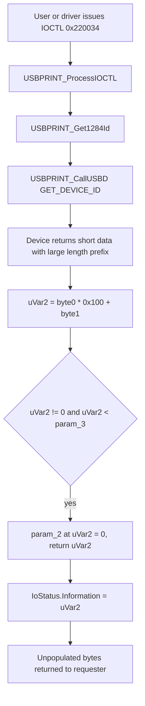

# CVE-2026-96250

**CVE:** CVE-2026-96250  
**Title:** Windows USB Print Driver Elevation of Privilege Vulnerability  
**Source:** [https://msrc.microsoft.com/update-guide/vulnerability/CVE-2026-96250](https://msrc.microsoft.com/update-guide/vulnerability/CVE-2026-96250)  
**Component(s):** usbprint.sys  
**Patched Date:** 2026-10-13T07:00:00  
**CWE:** Use after free in Windows USB Print Driver allows an authorized attacker to elevate privileges locally.  

---

## Related CVEs (Same Component)

This report covers 8 CVEs affecting the same component(s):

- **CVE-2026-96250**  
- CVE-2026-96253  
- CVE-2026-96254  
- CVE-2026-96301  
- CVE-2026-96304  
- CVE-2026-96310  
- CVE-2026-96319  
- CVE-2026-96860  

### Detailed Information

#### CVE-2026-96253

**Title:** Windows USB Print Driver Elevation of Privilege Vulnerability  
**Source:** [https://msrc.microsoft.com/update-guide/vulnerability/CVE-2026-96253](https://msrc.microsoft.com/update-guide/vulnerability/CVE-2026-96253)  
**Patched Date:** 2026-10-13T07:00:00  
**CWE:** Use after free in Windows USB Print Driver allows an authorized attacker to elevate privileges locally.  

#### CVE-2026-96254

**Title:** Windows USB Print Driver Elevation of Privilege Vulnerability  
**Source:** [https://msrc.microsoft.com/update-guide/vulnerability/CVE-2026-96254](https://msrc.microsoft.com/update-guide/vulnerability/CVE-2026-96254)  
**Patched Date:** 2026-10-13T07:00:00  
**CWE:** Use after free in Windows USB Print Driver allows an authorized attacker to elevate privileges locally.  

#### CVE-2026-96301

**Title:** Windows USB Print Driver Elevation of Privilege Vulnerability  
**Source:** [https://msrc.microsoft.com/update-guide/vulnerability/CVE-2026-96301](https://msrc.microsoft.com/update-guide/vulnerability/CVE-2026-96301)  
**Patched Date:** 2026-10-13T07:00:00  
**CWE:** Use after free in Windows USB Print Driver allows an authorized attacker to elevate privileges locally.  

#### CVE-2026-96304

**Title:** Windows USB Print Driver Elevation of Privilege Vulnerability  
**Source:** [https://msrc.microsoft.com/update-guide/vulnerability/CVE-2026-96304](https://msrc.microsoft.com/update-guide/vulnerability/CVE-2026-96304)  
**Patched Date:** 2026-10-13T07:00:00  
**CWE:** Use after free in Windows USB Print Driver allows an authorized attacker to elevate privileges locally.  

#### CVE-2026-96310

**Title:** Windows USB Print Driver Elevation of Privilege Vulnerability  
**Source:** [https://msrc.microsoft.com/update-guide/vulnerability/CVE-2026-96310](https://msrc.microsoft.com/update-guide/vulnerability/CVE-2026-96310)  
**Patched Date:** 2026-10-13T07:00:00  
**CWE:** Use after free in Windows USB Print Driver allows an authorized attacker to elevate privileges locally.  

#### CVE-2026-96319

**Title:** Windows USB Print Driver Elevation of Privilege Vulnerability  
**Source:** [https://msrc.microsoft.com/update-guide/vulnerability/CVE-2026-96319](https://msrc.microsoft.com/update-guide/vulnerability/CVE-2026-96319)  
**Patched Date:** 2026-10-13T07:00:00  
**CWE:** Use after free in Windows USB Print Driver allows an authorized attacker to elevate privileges locally.  

#### CVE-2026-96860

**Title:** Windows USB Print Driver Information Disclosure Vulnerability  
**Source:** [https://msrc.microsoft.com/update-guide/vulnerability/CVE-2026-96860](https://msrc.microsoft.com/update-guide/vulnerability/CVE-2026-96860)  
**Patched Date:** 2026-10-13T07:00:00  
**CWE:** Out-of-bounds read in Windows USB Print Driver allows an authorized attacker to disclose information locally.  

---

Download Patched & Vulnerable Components:

```bash
# usbprint.sys
wget https://msdl.microsoft.com/download/symbols/usbprint.sys/82D302931C000/usbprint.sys -O usbprint.sys.10.0.26100.9278 # vulnerable
wget https://msdl.microsoft.com/download/symbols/usbprint.sys/04F3731C1D000/usbprint.sys -O usbprint.sys.10.0.26100.9711 # patched
```

## Version Tracking Analysis

**Command:**

```
python ghidra_scripts\ghidra_vt_wrapper.py --old-binary ./reports/2026-Oct/CVE-2026-96250/usbprint.sys.10.0.26100.9278 --new-binary ./reports/2026-Oct/CVE-2026-96250/usbprint.sys.10.0.26100.9711 --project-dir ./reports/2026-Oct/CVE-2026-96250/ghidra_project --project-name usbprint.sys_CVE-2026-96250 --ghidra-dir C:\Tools\ghidra_11.4.2_PUBLIC_20250826\ghidra_11.4.2_PUBLIC --output-dir ./reports/2026-Oct/CVE-2026-96250/ghidra_project/vt_results --max-memory 16g
```

Patched Functions: 14 | New Functions: 10 | Removed Functions: 1 | Total Matches: 1719 | Accepted Matches: 1636

### Patched Functions

*Showing top 10 of 14 patched functions*

| Function Name | Source Address | Dest Address | Similarity | Confidence |
| --- | --- | --- | --- | --- |
| `USBPRINT_SetDeviceID` | `1400041c0` | `140003e00` | 0.957 | 10.0 |
| `DbgTraceWorker` | `140009980` | `14000a8f0` | 0.927 | 10.0 |
| `USBPRINT_ProcessIOCTL` | `140004970` | `140004b70` | 0.878 | 10.0 |
| `USBPRINT_SelectInterface` | `1400086e8` | `140009258` | 0.824 | 10.0 |
| `USBPRINT_RemoveDevice` | `1400085b4` | `1400090d4` | 0.819 | 10.0 |
| `USBPRINT_Dispatch` | `1400032d0` | `140002cb0` | 0.795 | 10.0 |
| `USBPRINT_Get1284Id` | `140001d40` | `140004a20` | 0.762 | 10.0 |
| `USBPRINT_CreateDeviceObject` | `140007b90` | `14000856c` | 0.683 | 10.0 |
| `ProduceQueriedID` | `140006cc0` | `1400071c0` | 0.666 | 10.0 |
| `RtlStringCbCopyA` | `140007600` | `140007d50` | 0.601 | 10.0 |

### New Functions

| Function Name | Address |
| --- | --- |
| `Feature_3253626168__private_IsEnabledDeviceUsageNoInline` | `140006434` |
| `Feature_3253626168__private_IsEnabledFallback` | `14000646c` |
| `USBPRINT_Copy1284IdLocked` | `1400084a0` |
| `USBPRINT_CopyDeviceIdStringLocked` | `140008504` |
| `Feature_419850555__private_IsEnabledDeviceUsageNoInline` | `14000a008` |
| `Feature_419850555__private_IsEnabledFallback` | `14000a040` |
| `USBPRINT_AbortPipe` | `14000a0b0` |
| `USBPRINT_AbortPipes` | `14000a16c` |
| `USBPRINT_DrainPipeUsers` | `14000a494` |
| `_guard_dispatch_icall` | `14000aca0` |

### Removed Functions

| Function Name | Address |
| --- | --- |
| `_guard_dispatch_icall` | `140009d30` |

---

# AI Technical Analysis

## Vulnerability Identification

**Core Vulnerable Function(s):**
- `USBPRINT_Get1284Id()` - Uses a length field read from the
  device's reply as the returned ID length. It never checks that
  length against the number of bytes the transfer actually
  delivered.

**Supporting Changes:**
- `USBPRINT_ProcessIOCTL()` - Caller. Its `0x220034`
  (GET_1284_ID) and `0x16000c` (IOCTL_PAR_QUERY_DEVICE_ID)
  handlers use the return value as a copy length and as
  `IoStatus.Information`. It also gains an I/O-count gate
  (`USBPRINT_CheckIncrementIoCount`), a drain step
  (`USBPRINT_DrainPipeUsers`) on protocol switch, and
  `__security_cookie` handling.
- `ProduceQueriedID()` - Adds fast-mutex-protected copies of the
  device ID strings (`USBPRINT_CopyDeviceIdStringLocked`,
  `USBPRINT_Copy1284IdLocked`). This is concurrency hardening
  around the same ID data. The diff does not show it calling
  `USBPRINT_Get1284Id()` directly.

**Unrelated Changes:**
- Variable renaming, register and stack-slot reallocation, and
  the `ulonglong` to `int` return type change in decompiler
  output. These do not alter behavior.
- Feature-flag plumbing (for example
  `Feature_Print_Modern_Printer_Driver_Ranking__private_IsEnabledDeviceUsageNoInline`)
  and the new `IOCTL 0x22004c`/`0x220050` restructuring. These
  are not part of the length-validation flaw.

---

## Root Cause Analysis

The driver trusted a length value supplied by the USB device. The
IEEE 1284 Device ID reply begins with a big-endian 16-bit length
in its first two bytes. `USBPRINT_Get1284Id()` used that value as
the ID length, and callers used it as a copy and reporting size.
The invariant that was violated is that the claimed length must
not exceed the number of bytes the control transfer actually
returned.

Vulnerable code (before):

```c
else {
  uVar2 = (uint)*param_2 * 0x100 + (uint)param_2[1];
  uVar5 = (ulonglong)uVar2;
  if ((uVar2 != 0) && ((int)uVar2 < param_3)) {
    param_2[uVar5] = 0;
    goto LAB_140001e30;
  }
}
uVar5 = 0xffffffff;
LAB_140001e30:
ExFreePool(puVar4);
return uVar5;
```

`param_2` is the destination buffer that receives the device
reply. `param_3` is the capacity the caller passed in, which the
URB stores as `puVar4[9] = param_3`. `uVar2` is assembled from
`param_2[0]` and `param_2[1]`, so the device fully controls it,
up to 0xFFFF.

The only validation is `uVar2 != 0` and `(int)uVar2 < param_3`.
That bounds the value by the caller's buffer capacity. It does
not bound it by how many bytes the device returned. A device can
transfer only a few bytes yet declare a length close to
`param_3`.

The function then writes a terminating NUL at `param_2[uVar5]`.
It returns `uVar5` as the ID length, even though the bytes
between the real transfer end and `uVar5` were never populated by
the device.

In the `0x220034` handler the result is stored in
`*(longlong *)(param_2 + 0x38)`, which is `IoStatus.Information`.
The unpopulated bytes of the output buffer are therefore reported
as valid data. In the `0x16000c` handler the same value drives
`memmove(_Dst, pbVar10 + 2, iVar7 - 1)` and
`IoStatus.Information`.

---

## Execution and Trigger Flow

An attacker needs a malicious or malformed USB printer-class
device, or a user-mode caller that can reach the device. The
attacker does not need to control the user buffer contents.

1. A caller issues `IOCTL_USBPRINT_GET_1284_ID` (`0x220034`)
   against the device. `USBPRINT_ProcessIOCTL()` takes
   `_Dst = *(param_2 + 0x18)` as the output buffer and
   `uVar5 = *(param_1 + 8)` as the output length.
2. The handler checks that `uVar5 != 0`, then calls
   `USBPRINT_Get1284Id(param_1, _Dst, uVar5, ...)`.
3. `USBPRINT_Get1284Id()` allocates a URB and sets
   `puVar4[9] = param_3`. It then submits the class-specific
   GET_DEVICE_ID control request through `USBPRINT_CallUSBD()`.
4. The device replies with a short payload whose first two bytes
   encode a large length, for example 0x01F0.
5. The function computes `uVar2 = 0x01F0` and passes the check
   `(int)uVar2 < param_3`.
6. It writes `param_2[0x1F0] = 0` and returns `0x1F0`.
7. The caller stores `*_Dst = (byte)iVar8`. It sets
   `*(param_2 + 0x38) = iVar8` and completes the IRP.
8. The I/O manager copies `iVar8` bytes back to the requester,
   including bytes the device never supplied.



---

## Patch Analysis

Patched code:

```diff
-    uVar2 = (uint)*param_2 * 0x100 + (uint)param_2[1];
-    uVar5 = (ulonglong)uVar2;
-    if ((uVar2 != 0) && ((int)uVar2 < param_3)) {
-      param_2[uVar5] = 0;
-      goto LAB_140001e30;
+    iVar6 = (uint)*param_2 * 0x100 + (uint)param_2[1];
+    uVar5 = Feature_419850555__private_IsEnabledDeviceUsageNoInline();
+    if (((char)uVar5 != '\0') && ((int)puVar4[9] < iVar6)) {
+      iVar6 = puVar4[9];
+    }
+    if ((0 < iVar6) && (iVar6 < param_3)) {
+      param_2[iVar6] = 0;
+      goto LAB_140004b25;
     }
   }
-  uVar5 = 0xffffffff;
+  iVar6 = -1;
```

The patch keeps the device-supplied length in a signed `int`
(`iVar6`). When the servicing feature flag
`Feature_419850555` is enabled, it clamps `iVar6` to `puVar4[9]`,
the URB transfer length field. The patch's own comparison implies
this field reflects the length the transfer completed with.

The existing bounds test is then applied to the clamped value.
The test is now `0 < iVar6` and `iVar6 < param_3`. This rejects
negative values as well as zero. The NUL terminator is written at
`param_2[iVar6]`, and the same `iVar6` is returned. The failure
path returns `-1`, and the function now returns `int` instead of
`ulonglong`. Callers therefore handle a signed result
consistently. `USBPRINT_ProcessIOCTL()` was updated to take
`iVar8 = USBPRINT_Get1284Id(...)` and test `-1 < iVar8`.

Effectiveness: the clamp removes the gap between the claimed
length and the transferred length. The returned length, the NUL
write offset, and the callers' copy and `Information` values can
no longer exceed the bytes that the URB recorded. The signed
check also closes any ambiguity from the 64-bit zero-extended
return.

The fix depends on the feature flag being enabled. Where the
flag is off, the old behavior is preserved. The clamp also trusts
`puVar4[9]` to hold the transferred length after completion. The
diff shows the comparison but not the URB layout, so this is
inferred from the patch.

Security impact: before the patch, a device-controlled length
field could make the driver report more valid data than the
device delivered. This exposed unpopulated buffer contents to the
requester, and the driver trusted unvalidated device input. After
the patch, the reported length is bounded by the actual transfer
size.