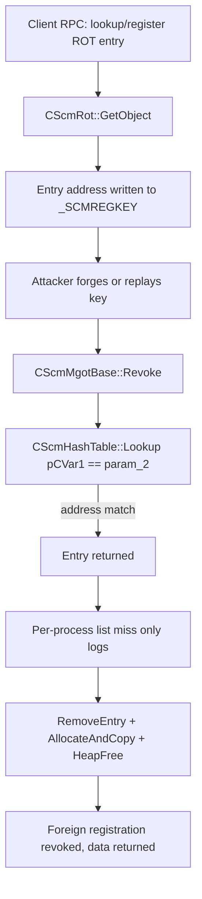

# CVE-2026-96300

**CVE:** CVE-2026-96300  
**Title:** RPC Endpoint Mapper Service Denial of Service Vulnerability  
**Source:** [https://msrc.microsoft.com/update-guide/vulnerability/CVE-2026-96300](https://msrc.microsoft.com/update-guide/vulnerability/CVE-2026-96300)  
**Component(s):** rpcss.dll  
**Patched Date:** 2026-10-13T07:00:00  
**CWE:** Uncontrolled resource consumption in RPC Endpoint Mapper Service allows an unauthorized attacker to deny service over a network.  

Download Patched & Vulnerable Components:

```bash
# rpcss.dll
wget https://msdl.microsoft.com/download/symbols/rpcss.dll/4B60D20A179000/rpcss.dll -O rpcss.dll.10.0.26100.9549 # vulnerable
wget https://msdl.microsoft.com/download/symbols/rpcss.dll/BD0E6D5D17A000/rpcss.dll -O rpcss.dll.10.0.26100.9711 # patched
```

## Version Tracking Analysis

**Command:**

```
python ghidra_scripts\ghidra_vt_wrapper.py --old-binary ./reports/2026-Oct/CVE-2026-96300/rpcss.dll.10.0.26100.9549 --new-binary ./reports/2026-Oct/CVE-2026-96300/rpcss.dll.10.0.26100.9711 --project-dir ./reports/2026-Oct/CVE-2026-96300/ghidra_project --project-name rpcss.dll_CVE-2026-96300 --ghidra-dir C:\Tools\ghidra_11.4.2_PUBLIC_20250826\ghidra_11.4.2_PUBLIC --output-dir ./reports/2026-Oct/CVE-2026-96300/ghidra_project/vt_results --max-memory 16g
```

Patched Functions: 9 | New Functions: 11 | Removed Functions: 1 | Total Matches: 58062 | Accepted Matches: 29066

### Patched Functions

| Function Name | Source Address | Dest Address | Similarity | Confidence |
| --- | --- | --- | --- | --- |
| `CScmRot::Register` | `1800fc2a4` | `1800fc4e4` | 0.987 | 10.0 |
| `CScmRot::GetObject` | `180011d64` | `180011d64` | 0.976 | 10.0 |
| `CScmMgotBase::RegisterCommon` | `180113484` | `180113984` | 0.968 | 10.0 |
| `CScmHashEntry::`scalar_deleting_destructor'` | `1800fc110` | `1800fc160` | 0.810 | 10.0 |
| `CScmHashTable::Lookup` | `18005d554` | `18010ebdc` | 0.810 | 10.0 |
| `CScmRotEntry::RevokeSelfForProcessExit` | `1800fcff0` | `1800fd2b0` | 0.789 | 10.0 |
| `CScmMgotEntry::RevokeSelfForProcessExit` | `180113d90` | `1801142a0` | 0.789 | 10.0 |
| `CScmRotMgotEntryBase::~CScmRotMgotEntryBase` | `1800717dc` | `1800715ec` | 0.789 | 10.0 |
| `CScmMgotBase::Revoke` | `180113b30` | `18011401c` | 0.691 | 10.0 |

### New Functions

*Showing 10 of 11 new functions*

| Function Name | Address |
| --- | --- |
| `SetScmRegKey` | `18001208c` |
| `CScmHashEntry` | `1800fc014` |
| `GetCachedFeatureEnabledState` | `1800fc21c` |
| `GetCurrentFeatureEnabledState` | `1800fc354` |
| `ReportUsage` | `1800fd21c` |
| `__private_IsEnabled` | `1800fd354` |
| `LookupOld` | `18010ec2c` |
| `RemoveEntryOld` | `18010ece4` |
| `ComTraceMessageT<CScmMgotBase*___ptr64,CScmMgotEntry*___ptr64,void*___ptr64>` | `180112518` |
| `SetMgotScmToken` | `180114358` |

### Removed Functions

| Function Name | Address |
| --- | --- |
| `_guard_dispatch_icall` | `1801223b0` |

---

# AI Technical Analysis

## Vulnerability Identification

**Core Vulnerable Function(s):**
- `CScmHashTable::Lookup()` - Identifies a registration by comparing
  the caller-supplied key against the raw entry address
  (`pCVar1 == param_2`). The key is a predictable heap pointer.
- `CScmRot::GetObject()` - Hands the raw `CScmRotMgotEntryBase`
  address back to the caller as the registration key
  (`*(CScmRotMgotEntryBase **)param_5 = pCVar8`). This exposes the
  heap address and creates the pointer-based key.

**Supporting Changes:**
- `CScmMgotBase::Revoke()` - Consumes the caller-controlled key from
  `param_2`. It calls the old pointer-keyed `Lookup()` and
  `RemoveEntry()`, which are now `LookupOld()` and `RemoveEntryOld()`
  behind a feature flag. The new path matches on a 32-bit id plus a
  64-bit random value.
- `CScmRotEntry::RevokeSelfForProcessExit()` - Builds the key for the
  internal revoke path. It now calls `SetScmRegKey()` instead of
  copying `this` into the key.
- `CScmRotEntry::SetScmRegKey()` (new) - Central key builder. When the
  feature is enabled it emits `*(this + 0x18)` (random value) in place
  of `this`.
- `CScmHashEntry::CScmHashEntry()` (new) - Constructor that stores an
  id at `this + 0x10` and fills `this + 0x18` with 8 bytes from
  `ProcessPrng()`.
- `CScmHashEntry::scalar_deleting_destructor()` - Zeroes the id field
  at `this + 0x10` so a freed entry cannot match a later lookup.

**Unrelated Changes:**
- `GetCachedFeatureEnabledState()`, `GetCurrentFeatureEnabledState()`
  and `ReportUsage()` - WIL feature-flag (Feature_2307107130) staging
  and telemetry plumbing. They are not security-relevant.
- Variable renaming and label address changes in
  `RevokeSelfForProcessExit()` and `GetObject()` are compiler and
  decompiler artifacts.

---

## Root Cause Analysis

The ROT/MGOT registration key (`_SCMREGKEY`) used the in-memory
address of the entry object as its identifying value. The server
treated possession of that value as proof of the right to revoke the
registration. This breaks the invariant that a capability handle must
be unguessable and must not be reusable after the object it names is
freed.

Vulnerable code in `CScmHashTable::Lookup()`:

```c
if (*(longlong *)(*(longlong *)this + (ulonglong)param_1 * 8) != 0) {
  pCVar1 = *(CScmHashEntry **)(*(longlong *)this +
                               (ulonglong)param_1 * 8);
  do {
    if (pCVar1 == param_2) {
      return pCVar1;
    }
    pCVar1 = *(CScmHashEntry **)(pCVar1 + 8);
```

Key generation in `CScmRot::GetObject()`:

```c
*(CScmRotMgotEntryBase **)param_5 = pCVar8;
*(undefined4 *)(param_5 + 8) = *(undefined4 *)(pCVar8 + 0x48);
*(undefined4 *)(param_5 + 0xc) = *(undefined4 *)(pCVar8 + 0x4c);
```

`GetObject()` writes the entry pointer `pCVar8` straight into the
output key `param_5`. The same pattern appears in
`RevokeSelfForProcessExit()` (`local_18 = this`). The key therefore
carries a server heap address, and no secret is mixed in.

`Lookup()` walks the bucket chain selected by `param_1`, a hash value
that is also taken from the key. It returns the first node whose
address equals `param_2`. The only entropy in the key is the heap
address, plus a small hash and a 32-bit value at `+0xc`. All of these
are either disclosed to clients or derivable from them.

The same address can be reissued. A freed entry's memory can be
reallocated to a new, unrelated registration. The old key then matches
the new entry, because the comparison is purely by address. The old
`CScmHashEntry` destructor did not clear any identifier, and the
entry had no generation or random field to distinguish an old
registration from its replacement.

`CScmMgotBase::Revoke()` adds to the exposure. When the entry is not
in the caller's per-process list (`param_1 + 0x98`), the old code only
emits a trace message ("attempted to revoke an entry that exists in
the MGOT table, but is not present in the process's RotMgot list").
It then jumps to `LAB_180113c80` and continues to call
`RemoveEntry()`, free `*(pCVar3 + 0x18)` and return the interface
data. Ownership is therefore not enforced, and revocation depends
entirely on the key being unguessable.

---

## Execution and Trigger Flow

An attacker is a local process that can call the ROT/MGOT RPC
interface served by `rpcss.dll`. First, the attacker registers or
looks up a ROT entry. `CScmRot::GetObject()` runs and copies the
entry pointer into the returned `_SCMREGKEY`, so the attacker learns
a valid server-side heap address and the layout of the key.

Second, the attacker crafts a key whose pointer field is the address
of a target entry. The address is either observed directly from the
disclosure above, or it is a previously issued address that the
allocator has reused for another registration. The hash field at
`param_2 + 0x18` is set to select the correct bucket.

Third, the attacker calls the revoke RPC. `CScmMgotBase::Revoke()`
takes the exclusive lock, resolves the table with
`GetScmHashTableForClsid()` and calls `CScmHashTable::Lookup()` with
`*(param_2 + 0x18)` and `*(param_2 + 0x10)`.

Fourth, `Lookup()` returns the entry because the address matches. The
vtable call at offset `0x10` is made, and its check on
`*(param_2 + 0x1c)` passes.

Fifth, the per-process list search misses, but the old code only
logs and proceeds. `RemoveEntry()` unlinks the entry. The reference
count is incremented and the interface data is copied to the caller
(`AllocateAndCopy`). The stored data is freed with `HeapFree`, and
`*(pCVar3 + 0x18)` is cleared.

The result is that a registration owned by another client is revoked
and its interface data is returned to the caller.



---

## Patch Analysis

The patch replaces the pointer key with an id plus a random secret:

```diff
 CScmHashEntry::CScmHashEntry(this, ulong param_1)
+  *(ulong *)(this + 0x10) = param_1;
+  if (feature enabled) ProcessPrng(this + 0x18, 8);

 CScmHashTable::Lookup(this, ulong param_1, ulong param_2,
                       __uint64 param_3)
-      if (pCVar1 == param_2) {
+      if ((*(ulong *)(pCVar1 + 0x10) == param_2) &&
+          (*(__uint64 *)(pCVar1 + 0x18) == param_3)) {

 CScmRotEntry::scalar_deleting_destructor
+  *(undefined4 *)(this + 0x10) = 0;

 CScmRot::GetObject
-  *(CScmRotMgotEntryBase **)param_5 = pCVar8;
+  CScmRotEntry::SetScmRegKey((CScmRotEntry *)this_00, param_5);
```

`CScmHashEntry` gains two fields. The 32-bit id at `this + 0x10` is
supplied by the constructor, and the 64-bit value at `this + 0x18` is
filled by `ProcessPrng()`. Every other member shifts by `0x10`, which
accounts for the changed offsets in `CScmMgotBase::Revoke()` and
`GetObject()`.

`SetScmRegKey()` now writes `*(this + 0x18)` into the first key
field instead of `this`. It writes the hash value from `this + 0x58`
at key offset 8 and the id from `this + 0x10` at key offset 0xc.
`GetObject()` and `RevokeSelfForProcessExit()` both use it, so the
heap address is no longer returned to clients.

`Lookup()` takes an extra argument and requires both the id and the
64-bit random value to match. `Revoke()` passes
`*(param_2 + 0x1c)` and `*(param_2 + 0x10)` accordingly. The
destructor zeroes the id before teardown, so a stale key can no
longer match a freed or recycled entry.

Effectiveness: removing the address from the key closes the heap
address disclosure through this path. A forged key must now match a
64-bit value from `ProcessPrng()` in addition to the id and hash,
which makes blind guessing infeasible. A recycled address no longer
helps the attacker, because the new entry gets a fresh random value.
The destructor change adds a second guard against stale-key matches.

Residual points visible in the diff are limited. `Revoke()` still
only traces when the entry is missing from the caller's per-process
list and then continues with removal, so the unguessable key is the
sole control. The old behavior remains reachable through
`LookupOld()` and `RemoveEntryOld()` when Feature_2307107130 is
disabled.

Security impact: the fix converts the registration key from a
disclosed, reusable heap address into a per-entry random capability.
This prevents a client from revoking or retrieving data for
registrations it does not own by replaying or reconstructing a key.